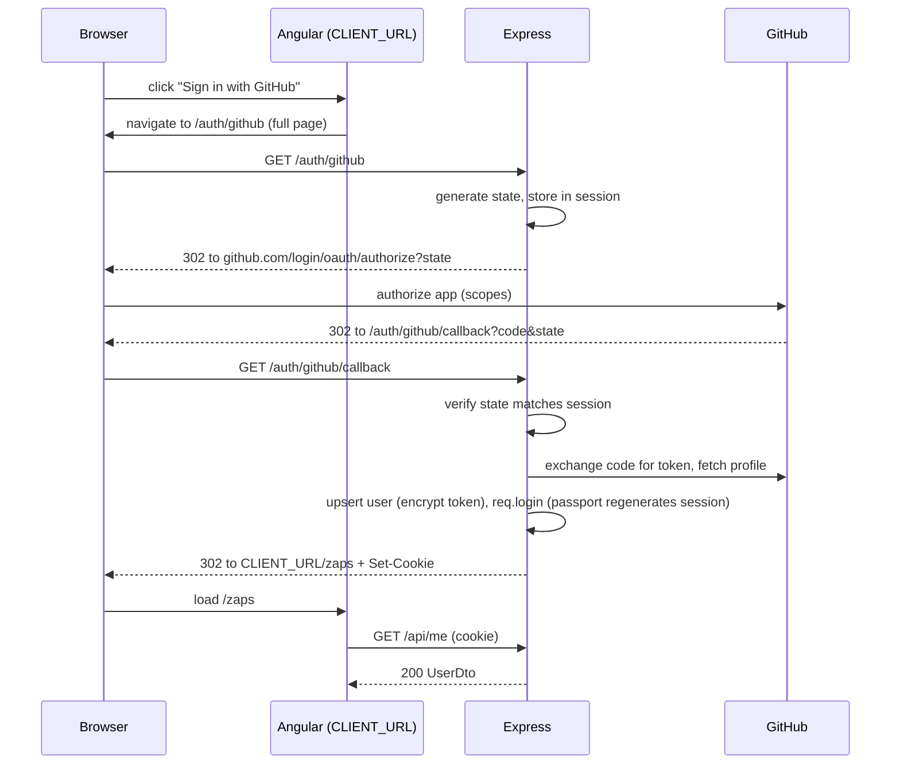
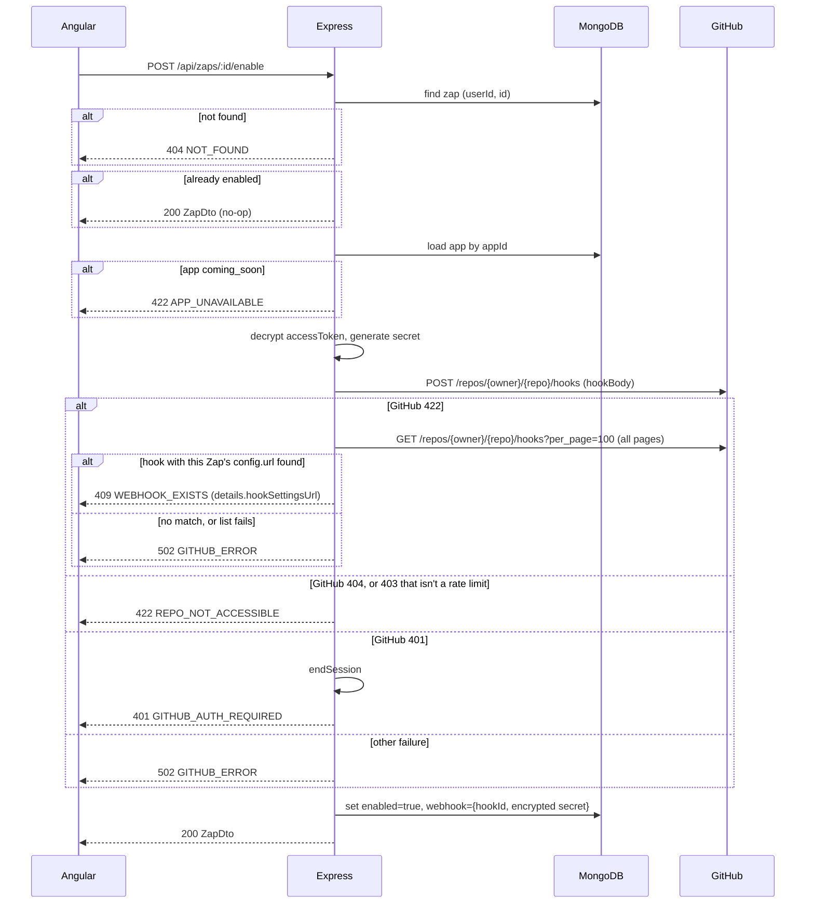

# API design
Express 5 server. Three route groups:

| Prefix | Purpose | Auth |
|---|---|---|
| `/auth` | GitHub OAuth sign-in / sign-out (browser redirects) | — |
| `/api` | JSON API used by the Angular client | Session required |
| `/webhooks` | GitHub webhook receiver | HMAC signature |

Data shapes referenced here are defined in [Data-model.md](Data-model.md). Request schemas are zod schemas in `/shared`, imported by both server and client.

## Conventions
- **Format:** JSON in and out. Every `POST` / `PATCH` under `/api`, and `POST /auth/logout`, requires `Content-Type: application/json` (`requireJson`, checked strictly with `req.is('application/json')`), otherwise `415`. `DELETE` has no body and isn't checked.
- **Auth:** session cookie `zaps.sid` set by express-session (httpOnly, `sameSite=lax`, 7-day lifetime). The client sends it with `withCredentials: true`. Any `/api` route without a valid session returns `401`.
- **Ending a session:** one shared helper, `endSession(req, res)`, is used by both `POST /auth/logout` and the `GITHUB_AUTH_REQUIRED` path. It waits for each async step before the next: `req.logout(cb)` (async in passport 0.7), then `req.session.destroy(cb)`, then `res.clearCookie('zaps.sid')`, then the response is sent.
- **CSRF:** no CSRF token. The protection has three parts:
  - `sameSite=lax` keeps the cookie off requests from other *sites*. But every `localhost:*` origin counts as the same site, so it doesn't stop another local app on a different port.
  - The real protection is the **CORS preflight**: a cross-origin `application/json` POST, or any PATCH/DELETE, triggers a preflight, and CORS rejects every origin except `CLIENT_URL`.
  - `requireJson` must stay strict, so a "simple" request (form or `text/plain` POST, which skips preflight) can never reach a write handler.
- **CORS:** only `CLIENT_URL` is allowed, with `credentials: true`.
- **Ownership:** every `/api/zaps/**` route is scoped to the session user. Another user's Zap returns `404`.
- **IDs:** MongoDB ObjectIds are exposed as `id` (string). An invalid ObjectId in a path returns `404`.
- **Dates:** ISO 8601 strings.
- **Pagination:** none for Zaps (few per user). Runs return the latest 50.
- **Body size:** the Express default limit of **100 KB** is kept for `express.json()` and the webhook's `express.raw()`; larger bodies get `413 PAYLOAD_TOO_LARGE`. This is a known, accepted limitation:
  - **Zap save:** a template near the 65,536-unit maximum made mostly of non-ASCII text (emoji ~131 KB, CJK ~196 KB as UTF-8 JSON) is rejected even though it passes validation. ASCII templates (~65 KB) fit.
  - **Webhook:** a PR whose description is long and mostly non-ASCII can push the `pull_request` payload past 100 KB. GitHub then gets a `413`, marks the delivery failed, and no run is recorded, so the Zap silently doesn't comment on that PR.

### Errors
Every error uses the same envelope:
```json
{ "error": { "code": "VALIDATION_ERROR", "message": "Invalid request body", "details": [{ "path": ["name"], "message": "Required" }] } }
```
`details` is optional and its shape depends on `code`: zod issues for `VALIDATION_ERROR`, `{ hookSettingsUrl }` for `WEBHOOK_EXISTS`.

| Status | `code` | When |
|---|---|---|
| 400 | `VALIDATION_ERROR` | Body or query fails zod validation (`details` = zod issues), including an invalid ObjectId in a query string (e.g. `?appId=abc`), unknown `app + event`, unknown `{{token}}`, `appId` doesn't match `trigger.app`. |
| 401 | `UNAUTHENTICATED` | No or expired session. |
| 401 | `GITHUB_AUTH_REQUIRED` | GitHub rejected the stored token (revoked or expired). The server **ends the session** with `endSession` before responding, so the user is really signed out and the login screen can be reached. The client then sends the user back through sign-in. |
| 404 | `NOT_FOUND` | Resource doesn't exist or isn't owned by the user. |
| 413 | `PAYLOAD_TOO_LARGE` | Request body over the parser limit. Limits are the Express defaults (**100 KB**) for both `express.json()` and the webhook's `express.raw()`; see Conventions. The error handler maps body-parser's `entity.too.large` error to this envelope. |
| 415 | `UNSUPPORTED_MEDIA_TYPE` | Write without `application/json`. |
| 422 | `APP_UNAVAILABLE` | Enabling a Zap whose app is `coming_soon`. |
| 409 | `WEBHOOK_EXISTS` | Enabling (or moving) a Zap found this Zap's own webhook still on the repo, left over from an earlier best-effort removal. `details` = `{ hookSettingsUrl }`, a link to that webhook on GitHub. The user deletes it there and tries again. |
| 422 | `REPO_NOT_ACCESSIBLE` | The repo doesn't exist, isn't public, the user lacks admin rights to add a webhook, or the repo's organization restricts OAuth App access (GitHub 403/404). |
| 502 | `GITHUB_ERROR` | Any other GitHub API failure, including rate limits (GitHub sends secondary rate limits as 403 with `retry-after` or `x-ratelimit-remaining: 0`). |
| 500 | `INTERNAL_ERROR` | Unexpected error. No stack trace or internal details in the body. |

## DTOs
Response shapes (TS types in `/shared`):

```ts
type UserDto = {
  id: string;
  login: string;
  name: string | null;
  avatarUrl: string;
};

type AppDto = {
  id: string;
  key: string;
  name: string;
  icon: string;
  status: 'available' | 'coming_soon';
  order: number;
  triggers: { key: string; name: string; description: string }[];
  actions: { key: string; name: string; description: string }[];
};

type ZapStep = {
  app: string;
  event: string;
  config: Record<string, unknown>;
};

type ZapDto = {
  id: string;
  appId: string;
  name: string;
  enabled: boolean;
  trigger: ZapStep;
  action: ZapStep;
  createdAt: string;
  updatedAt: string;
};

type ZapRunDto = {
  id: string;
  status: 'pending' | 'success' | 'failed';
  input: { prNumber: number; prUrl: string };
  output: { commentUrl: string } | null;
  error: string | null;
  createdAt: string;
  updatedAt: string;
};

type RepoDto = {
  owner: string;
  repo: string; // same names as trigger.config { owner, repo }
  fullName: string;
  htmlUrl: string;
};
```

Never exposed: `users.accessToken`, `zaps.userId`, `zaps.webhook` (hook id and secret).

## Endpoints

### Auth
| Method | Path | Description |
|---|---|---|
| GET | `/auth/github` | Starts OAuth (Passport, strategy option `state: true`). Redirects to GitHub with scopes `public_repo admin:repo_hook` and a random `state` stored in the session. |
| GET | `/auth/github/callback` | GitHub redirects here. Passport checks `state` (mismatch counts as failure). The server upserts the user by `githubId` (profile, encrypted token) and calls `req.login`, which in passport 0.7 regenerates the session id itself (no manual regenerate). It then redirects to `CLIENT_URL/zaps`. On failure or denial, redirects to `CLIENT_URL/login?error=oauth`. |
| POST | `/auth/logout` | Body `{}` (`requireJson` applies). Calls `endSession` (logout, destroy session, clear `zaps.sid`). `204`. Also `204` when there's no session (safe to repeat). |



### Current user
| Method | Path | Response |
|---|---|---|
| GET | `/api/me` | `200 UserDto`, or `401` (the client uses this to decide whether to show login). |

### Apps
| Method | Path | Response |
|---|---|---|
| GET | `/api/apps` | `200 AppDto[]`, sorted by `order`. Feeds the app picker; `coming_soon` apps are shown but can't be selected. |

### GitHub helpers
| Method | Path | Response |
|---|---|---|
| GET | `/api/github/repos` | `200 RepoDto[]`. The user's public repos where they have **admin** permission (required to create a webhook). Fetched from `GET /user/repos?visibility=public&affiliation=owner,collaborator,organization_member&sort=pushed&per_page=100`, all pages, then filtered to `permissions.admin === true`. Sorted by most recently pushed. Not cached on the server. The builder calls it **once** when it opens and filters the list on the client while the user types, so it doesn't page through GitHub on every keystroke. Errors: GitHub `401` → `401 GITHUB_AUTH_REQUIRED` (session ended with `endSession`); anything else, including rate limits → `502 GITHUB_ERROR`. `REPO_NOT_ACCESSIBLE` doesn't apply to a list. |

### Zaps
| Method | Path | Body | Response |
|---|---|---|---|
| GET | `/api/zaps?appId=` | — | `200 ZapDto[]`, sorted by `updatedAt` desc. Optional `appId` filters to Zaps of one app; an invalid ObjectId returns `400 VALIDATION_ERROR`. |
| POST | `/api/zaps` | `{ appId, name, trigger, action }` | `201 ZapDto`. Always created with `enabled: false`. |
| GET | `/api/zaps/:id` | — | `200 ZapDto` |
| PATCH | `/api/zaps/:id` | Any of `{ appId, name, trigger, action }` | `200 ZapDto` |
| DELETE | `/api/zaps/:id` | — | `204` |
| POST | `/api/zaps/:id/enable` | — (empty `{}`) | `200 ZapDto` |
| POST | `/api/zaps/:id/disable` | — (empty `{}`) | `200 ZapDto` |
| GET | `/api/zaps/:id/runs` | — | `200 ZapRunDto[]`, latest 50, `createdAt` desc. |

**Validation (POST and PATCH).**
- `trigger` and `action` are each validated by the zod schema for their `app + event` (see Data-model).
- `appId` must reference an existing app whose `key` equals `trigger.app`.
- Every `{{token}}` in action string fields must belong to the trigger's token list.
- PATCH merges at the top level only: a sent `trigger` or `action` replaces the whole step (no deep merge). The **merged** Zap is validated as a whole, so changing `trigger.app` also requires a matching `appId`.

**Side effects.**
- **PATCH on an enabled Zap that changes the trigger repo** (the repo counts as changed when `owner` or `repo` differs, compared case-insensitively, since GitHub names are case-insensitive):
  1. Create the new webhook on the new repo with the same **create-webhook** routine as Enable. Moving back to a repo that still has this Zap's leftover hook returns `409 WEBHOOK_EXISTS`, and nothing is saved.
  2. Save the Zap with the new trigger and new `webhook`.
  3. Remove the old webhook, best-effort (same rules as Disable).
  - If step 1 fails, nothing changes and the request returns `409 WEBHOOK_EXISTS`, `422 REPO_NOT_ACCESSIBLE`, `401 GITHUB_AUTH_REQUIRED` or `502 GITHUB_ERROR`.
  - If step 2 fails, the server removes the hook it just created (best-effort) and returns `500`.
- **Enable:**
  - Checks the app is `available` (`422 APP_UNAVAILABLE`).
  - Runs the **create-webhook** routine on `trigger.config.owner/repo` (below).
  - Stores `webhook`, sets `enabled: true`.
  - Calling it on an already-enabled Zap is a no-op `200`.
  - **Accepted risk: concurrent enables.** There's no server-side lock. If two enable requests for the same Zap overlap (double click, two tabs), the second one's create gets GitHub's 422, finds the hook the first request just made, and returns `409 WEBHOOK_EXISTS`. The dialog would then point at the *live* webhook, and deleting it would break the Zap until it's turned off and on again. The UI disables the toggle while a request runs, so this needs two tabs; accepted for this version.
  - On failure the Zap stays disabled (`409 WEBHOOK_EXISTS`, `422 REPO_NOT_ACCESSIBLE`, `401 GITHUB_AUTH_REQUIRED`, `502 GITHUB_ERROR`).
- **Disable / Delete:**
  - Local state wins. The Zap is disabled (or deleted, along with its `zapRuns`) even if removing the webhook on GitHub fails.
  - Removing the webhook is best-effort; a GitHub 404 counts as removed.
  - A webhook left behind stays on the repo but triggers nothing: its deliveries match no Zap and get `204`. Re-enabling the same Zap on that repo returns `409 WEBHOOK_EXISTS` until the user deletes the leftover webhook on GitHub. Other Zaps have different URLs, so they're never blocked.
  - This keeps a user with a revoked token from getting stuck with a Zap they can't turn off.
  - If the GitHub call returns `401`, disable/delete still succeed locally; the session isn't destroyed here, because the user's action did succeed.
  - Disabling an already-disabled Zap is a no-op `200`.

**Create-webhook routine** (used by Enable and by the repo move in PATCH). The hook body is built by a single helper:
```ts
const hookBody = {
  active: true,
  events: ['pull_request'],
  config: { url: `${WEBHOOK_PUBLIC_URL}?zap=${zapId}`, content_type: 'json', secret, insecure_ssl: '0' },
};
```
- `content_type: 'json'` is required, because GitHub defaults to form-encoded bodies.
- The `?zap=` query string makes the URL unique per Zap, because GitHub rejects two hooks with the same URL and overlapping events on one repo.
- `secret` is a fresh random 32 bytes on every create.

Steps:
1. `POST /repos/{owner}/{repo}/hooks` with `hookBody`. On success, use the returned id.
2. On a `422` from GitHub, check whether this Zap's own webhook is already on the repo:
   - List the repo's hooks with `GET /repos/{owner}/{repo}/hooks?per_page=100`, following **every page**.
   - Look for a hook whose `config.url` equals this Zap's URL. The URL contains the Zap id, so a match proves it's this Zap's leftover hook. There's no need to parse GitHub's error text (which sits in `errors[].message`, not the top-level `message`).
3. **Found:** return `409 WEBHOOK_EXISTS` with `details: { hookSettingsUrl: 'https://github.com/{owner}/{repo}/settings/hooks/{id}' }`. The server does **not** modify or delete that hook; the user removes it on GitHub, then tries again.
4. Error mapping for everything else in the routine:
   - GitHub `401`: `401 GITHUB_AUTH_REQUIRED` (session ended).
   - GitHub `403` that is a **rate limit** (has a `retry-after` header, or `x-ratelimit-remaining: 0`): `502 GITHUB_ERROR`. GitHub reports secondary rate limits as 403, and they must not be shown as an access problem.
   - Any other GitHub `403`, or a `404`: `422 REPO_NOT_ACCESSIBLE`.
   - A `422` with no matching hook (some other validation error), a failed list call, or any other failure: `502 GITHUB_ERROR`.



### Webhook receiver
| Method | Path | Description |
|---|---|---|
| POST | `/webhooks/github` | Receives every Zap's GitHub deliveries. |

How a delivery is handled:
- The Zap is found by the `X-GitHub-Hook-ID` header, which matches `zaps.webhook.hookId`. The `?zap=<zapId>` query string exists only to make each hook URL unique on GitHub; routing doesn't depend on it.
- The route uses `express.raw({ type: 'application/json' })` and is mounted **before** `express.json()`, so the HMAC is checked against the raw request bytes.
- **Signature check:**
  1. The `X-Hub-Signature-256` header must start with `sha256=`, followed by 64 hex chars; otherwise `401`.
  2. Compute `HMAC-SHA256(secret, rawBody)` as a hex digest.
  3. Compare the two as Buffers: check the lengths are equal first, then use `crypto.timingSafeEqual`.
- **In dev (smee):** smee keeps the query string and passes GitHub's headers through. But it re-serializes the JSON body, so the raw bytes may differ from what GitHub signed (see the smee caveat in [Tech-Stack.md](Tech-Stack.md#server-dev--test)).

Full flow (dedupe via the `pending` run, status codes) is in [Data-model.md → zapRuns](Data-model.md#zapruns). Responses:

| Status | When |
|---|---|
| `200` | Processed (run recorded), or duplicate delivery skipped. |
| `204` | Ignored: unknown hook id, Zap disabled, `ping`, or a `pull_request` action other than `opened`. |
| `401` | Missing or invalid `X-Hub-Signature-256`. This includes form-encoded deliveries: `express.raw({ type: 'application/json' })` leaves the body empty, so the HMAC can't match. |
| `413` | Payload over 100 KB (see Conventions → Body size). Not recorded. |

The receiver never returns `5xx` for a failed GitHub comment. That failure is recorded as a `failed` run, so GitHub doesn't flag the hook as broken.

## Middleware order
1. `helmet()`
2. `cors({ origin: CLIENT_URL, credentials: true })`
3. `/webhooks` router (`express.raw`)
4. `express.json()`
5. `express-session` (connect-mongo store)
6. `passport.initialize()`, `passport.session()`
7. `/auth` router (`requireJson` on `POST /auth/logout`)
8. `/api` router: `requireAuth`, `requireJson` on POST/PATCH (not DELETE, which has no body), then the routes
9. 404 handler (`404 NOT_FOUND` envelope for unknown routes), then the error handler (maps zod / GitHub / known errors to the envelope)

## Configuration (env vars)
| Variable | Example | Purpose |
|---|---|---|
| `PORT` | `3000` | Server port. |
| `CLIENT_URL` | `http://localhost:4200` | CORS origin and post-login redirect. |
| `MONGODB_URI` | `mongodb://localhost:27017/zaps` | |
| `SESSION_SECRET` | random | Signs the session cookie. |
| `GITHUB_CLIENT_ID` / `GITHUB_CLIENT_SECRET` | — | OAuth App credentials. |
| `GITHUB_CALLBACK_URL` | `http://localhost:3000/auth/github/callback` | Must match the OAuth App setting. |
| `WEBHOOK_PUBLIC_URL` | `https://smee.io/<channel>` | Base URL GitHub posts to (each hook adds `?zap=<zapId>`); smee-client forwards it to `http://localhost:3000/webhooks/github`. |
| `TOKEN_ENCRYPTION_KEY` | base64, 32 bytes | AES-256-GCM key for tokens and webhook secrets. |

The server validates all of these at startup (zod) and refuses to start if any is missing.
