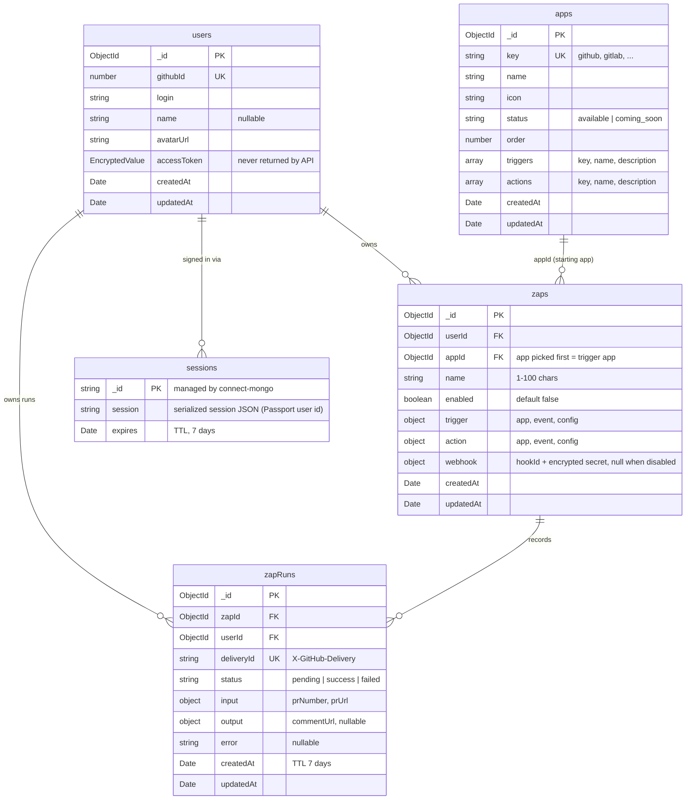
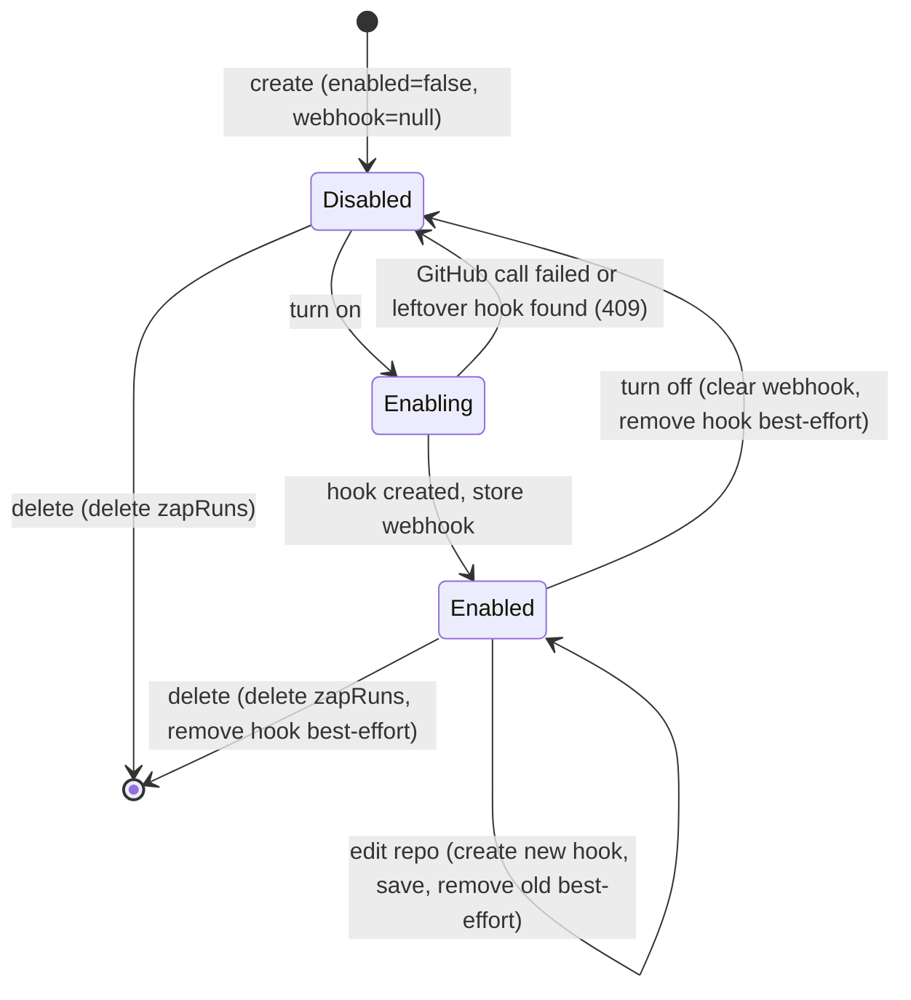
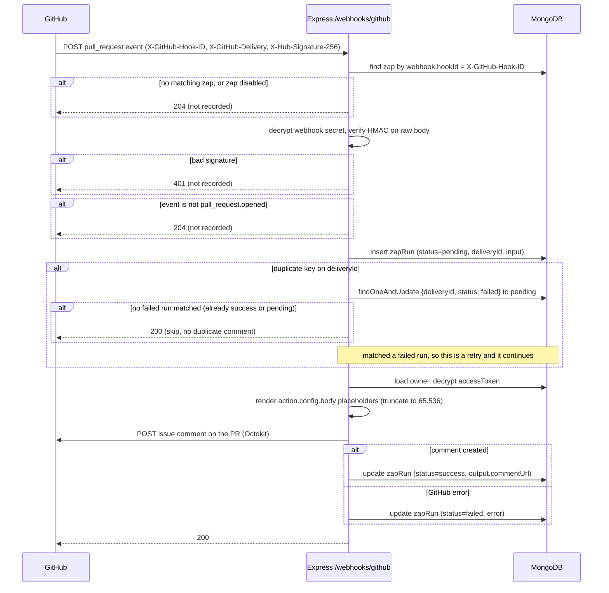

# Data model
MongoDB via Mongoose. `createdAt` / `updatedAt` are managed by Mongoose `timestamps` on every app-defined collection (`sessions` is managed by connect-mongo).

## Overview


`zaps.appId` is an ObjectId reference to `apps`. Inside `trigger` / `action`, `app` is a reference by `key` (validated in code).

## Shared type: `EncryptedValue`
AES-256-GCM output (see [Tech-Stack.md → GitHub integration](Tech-Stack.md#github-integration)), all base64 strings:
```ts
{ iv: string; authTag: string; ciphertext: string }
```

## `users`
| Field | Type | Notes |
|---|---|---|
| `_id` | ObjectId | |
| `githubId` | number | Unique index. GitHub's stable user id (logins can change). |
| `login` | string | Updated on each sign-in. |
| `name` | string \| null | |
| `avatarUrl` | string | From passport-github2's `profile._json.avatar_url`. |
| `accessToken` | EncryptedValue | GitHub OAuth token. Never returned by the API. |
| `createdAt` | Date | First sign-in. |
| `updatedAt` | Date | Last profile/token refresh. |

Upserted by `githubId` on each sign-in (profile and token refreshed).

## `zaps`
| Field | Type | Notes |
|---|---|---|
| `_id` | ObjectId | |
| `userId` | ObjectId → users | Owner. Required. |
| `appId` | ObjectId → apps | Required. The app the user picks first when creating the Zap, which is the trigger's app. Must be the same app as `trigger.app`; if the trigger app changes, `appId` changes with it. Used to list a user's Zaps per app. |
| `name` | string | 1–100 chars. |
| `enabled` | boolean | Default `false`. |
| `trigger` | `{ app, event, config }` | See below. |
| `action` | `{ app, event, config }` | See below. |
| `webhook` | `{ hookId: number, secret: EncryptedValue }` \| null | Set only while the Zap is enabled. One GitHub webhook per Zap. `hookId` is how incoming deliveries find their Zap (`X-GitHub-Hook-ID` header). |
| `createdAt` | Date | |
| `updatedAt` | Date | Used to sort the Zap list. |

Indexes: `{ userId: 1, updatedAt: -1 }` (list a user's Zaps), `{ userId: 1, appId: 1, updatedAt: -1 }` (list a user's Zaps for one app), `{ 'webhook.hookId': 1 }` unique with `partialFilterExpression: { 'webhook.hookId': { $type: 'number' } }` (route an incoming delivery to its Zap). The filter must be on `hookId`'s type, not on `webhook` existing: disabled Zaps store `webhook: null`, which `$exists` still matches, so a second disabled Zap would hit a duplicate key on `null`.

**Trigger / action shape.** `app` and `event` reference an entry in the `apps` collection. `config` is validated by a zod schema in `/shared`, chosen by `app + event`. An unknown `app + event` pair is rejected.

| Step | app | event | config |
|---|---|---|---|
| Trigger | `github` | `pull_request.opened` | `{ owner: string, repo: string }` |
| Action | `github` | `pull_request.comment` | `{ body: string }`, 1–65,536 chars (GitHub's comment limit) |

The action comments on the PR that fired the trigger, so the action config has no repo or PR number.

**Field mapping.** Action string fields can include `{{token}}` placeholders taken from the trigger's output. Placeholders are plain string substitution, with no expressions or logic. Unknown tokens are rejected when the Zap is saved. Tokens for `github / pull_request.opened`:

| Token | Value |
|---|---|
| `{{pr.number}}` | PR number |
| `{{pr.title}}` | PR title |
| `{{pr.body}}` | PR description (empty string if none) |
| `{{pr.url}}` | PR HTML URL |
| `{{pr.author}}` | PR author login |
| `{{repo.name}}` | Repo name |
| `{{repo.fullName}}` | `owner/repo` |

The template is limited to 65,536 chars, but token values (especially `{{pr.body}}`) can make the rendered comment longer. The renderer in `/shared` truncates the **rendered** output to 65,536 chars (the last char replaced by `…` when cut), so GitHub never rejects the comment for length. It truncates by code point (`Array.from(text)`), not by JS `length` (UTF-16 units), so an emoji or other astral character is never split in half. Counting code points keeps the result at or under GitHub's limit. (It can still split a multi-part emoji, such as a ZWJ family, or a letter from its combining accent at the cut; that's cosmetic only.)

The **template** limit (zod `.max(65536)` and the builder's counter) counts JS `length`, i.e. UTF-16 units, on purpose. That's stricter than code points (an emoji counts as 2), so a valid template never exceeds GitHub's limit on its own. The two counts differ only on that safe side.

**Lifecycle rules.**
- Enabling a Zap requires its trigger app to have status `available`. The server creates the webhook (URL unique per Zap, `?zap=<zapId>`) with a random 32-byte secret and stores `webhook`. If the GitHub call fails, the Zap stays disabled.
- If this Zap's own webhook (same URL) is still on the repo from an earlier best-effort removal, GitHub refuses the create. The server doesn't touch that hook: the Zap stays disabled and the user gets `409 WEBHOOK_EXISTS` with a link to delete it on GitHub, then tries again. This **create-webhook** routine is detailed in [API.md](API.md#zaps).
- Disabling or deleting a Zap clears `webhook` (or deletes the document) and removes the webhook on GitHub on a best-effort basis: a GitHub 404 counts as already removed, and any other GitHub failure doesn't block the disable/delete.
- A webhook left behind this way stays on the repo but triggers nothing: its deliveries match no `webhook.hookId` and get `204`. Turning the same Zap on again for that repo is blocked with `409 WEBHOOK_EXISTS` until the user deletes it (rule above). A different Zap has a different URL, so it's never blocked.
- Editing the trigger repo of an enabled Zap moves the webhook in this order:
  1. Create the new hook with the same create-webhook routine (a leftover hook of this Zap on the new repo blocks the move with `409 WEBHOOK_EXISTS`).
  2. Save the Zap with the new `webhook`.
  3. Remove the old hook, best-effort.
  - If step 1 fails, nothing changes.
  - If step 2 fails, the newly created hook is removed (best-effort) and the request fails with `500`.
- Deleting a Zap also deletes its `zapRuns`.



`Enabling` is transient (a single request), not a stored value; only `enabled: true | false` is persisted.

**Ownership.** Every Zap query is scoped by `userId` from the session. A Zap owned by someone else returns `404` (not `403`), so its existence isn't revealed.

## `zapRuns`
One document per Zap execution.

| Field | Type | Notes |
|---|---|---|
| `_id` | ObjectId | |
| `zapId` | ObjectId → zaps | |
| `userId` | ObjectId → users | Lets run lists be scoped by owner. |
| `deliveryId` | string | GitHub `X-GitHub-Delivery`. Unique index. Claiming it is what stops a delivery from commenting twice. |
| `status` | `'pending' \| 'success' \| 'failed'` | Inserted as `pending` **before** the comment is posted, then updated to `success` or `failed`. A redelivery can move `failed` back to `pending` (retry). |
| `input` | `{ prNumber: number, prUrl: string }` | Summary of the trigger event. |
| `output` | `{ commentUrl: string }` \| null | Set on success. |
| `error` | string \| null | Set on failure (GitHub error message/status). |
| `createdAt` | Date | TTL index: expires after **7 days**. |
| `updatedAt` | Date | Set when the run moves out of `pending`. |

Indexes: `{ deliveryId: 1 }` unique, `{ zapId: 1, createdAt: -1 }`, TTL on `createdAt`.

Events that don't match (e.g. `ping`, or `pull_request` with an action other than `opened`) are acknowledged and not recorded. Deliveries for a disabled Zap are ignored the same way.

How a webhook delivery becomes a `zapRuns` document:


**Deduplication.** Inserting the `pending` run *is* the claim on the delivery. MongoDB's unique index on `deliveryId` lets exactly one insert succeed, so only that request posts a comment. Any other request with the same `deliveryId` (a manual redelivery or two identical deliveries at once) gets a duplicate-key error.

**Retrying a failed run.** On a duplicate key, the server tries one atomic `findOneAndUpdate({ deliveryId, status: 'failed' }, { status: 'pending', error: null })`.
- If it matches, the earlier attempt failed, so this redelivery re-claims the run and posts the comment. This is how a user recovers from a temporary failure: "Redeliver" in the repo's webhook settings on GitHub (Settings → Webhooks → the hook → Recent Deliveries). The app has no UI for this, so the step goes in the project README.
- **Accepted risk:** a `failed` run is assumed not to have posted a comment. That's not always true: if GitHub times out or returns a `5xx` *after* creating the comment, the run is still recorded as `failed`, and a later redelivery posts a duplicate. This is accepted for this version, because redelivery is manual and rare.
- If it doesn't match, the run is `success` or `pending`, and the delivery is skipped.
- Because the update is atomic, two concurrent redeliveries can't both re-claim the same failed run.

**Stuck `pending` runs.** If the server dies after the claim but before the update, the run stays `pending` until the TTL removes it. It is never retried, not even by redelivery, because the comment might already have been posted and retrying could duplicate it.

**Revoked tokens.** If the user revokes the app's token on GitHub, each later comment call fails with `401` and is recorded only as a `failed` run. Without a run-history UI, the user notices only the next time they use the app (any `/api` call that hits GitHub signs them out with `GITHUB_AUTH_REQUIRED`). This is accepted for this version. `GET /api/zaps/:id/runs` remains the way to debug it.

**Response timing.** The comment is posted synchronously before the receiver answers GitHub. GitHub waits 10 seconds for a reply, and one comment call fits comfortably. If GitHub ever times out, it marks the delivery failed on its side, but the run is still recorded correctly here.

## `apps`
The app picker catalog.

| Field | Type | Notes |
|---|---|---|
| `_id` | ObjectId | |
| `key` | string | Unique. `github`, `gitlab`, `jira`, `linear`, `slack`. |
| `name` | string | Display name. |
| `icon` | string | Asset path in the client: `assets/apps/<key>.svg`. Placeholder SVGs for now (colored rounded square with the app's initials), swappable for real logos without code changes. |
| `status` | `'available' \| 'coming_soon'` | Only `github` is `available`. |
| `order` | number | Picker sort order. |
| `triggers` | `{ key, name, description }[]` | e.g. `pull_request.opened`. Empty for coming-soon apps. |
| `actions` | `{ key, name, description }[]` | e.g. `pull_request.comment`. |
| `createdAt` | Date | |
| `updatedAt` | Date | Last seed upsert. |

- Populated by a manual seed script (`npm run seed -w server`) that upserts the seed list in `/shared` by `key`. Run it after cloning and whenever the seed list changes.
- Seed list:

  | `key` | `name` | `status` | `order` | `icon` | Triggers / actions |
  |---|---|---|---|---|---|
  | `github` | GitHub | `available` | 1 | `assets/apps/github.svg` | Trigger `pull_request.opened`, "Pull request opened": "Triggers when a pull request is opened in a repository." Action `pull_request.comment`, "Comment on the pull request": "Posts a comment on the pull request that triggered the Zap." |
  | `gitlab` | GitLab | `coming_soon` | 2 | `assets/apps/gitlab.svg` | none (empty lists) |
  | `jira` | Jira | `coming_soon` | 3 | `assets/apps/jira.svg` | none |
  | `linear` | Linear | `coming_soon` | 4 | `assets/apps/linear.svg` | none |
  | `slack` | Slack | `coming_soon` | 5 | `assets/apps/slack.svg` | none |
- Config schemas and placeholder tokens stay in code (`/shared`), not in this collection.

## `sessions`
Managed entirely by connect-mongo. The app doesn't define a model for it.

| Field | Type | Notes |
|---|---|---|
| `_id` | string | Session id (the value signed into the cookie). |
| `session` | string | Serialized session JSON (Passport user id). |
| `expires` | Date | TTL index; MongoDB removes expired sessions. Lifetime 7 days (connect-mongo `ttl`, same as the cookie `maxAge`). |

