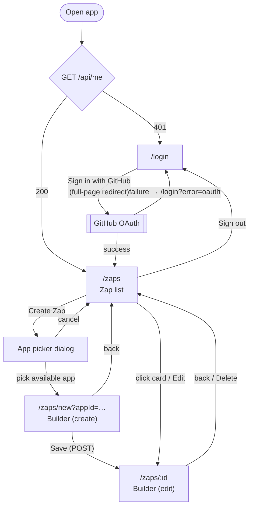

# Screens
Angular 16 (standalone components) + Angular Material 16 (`indigo-pink` prebuilt theme, no custom theming). API calls are defined in [API.md](API.md).

## Navigation


## Routes
| Path | Screen | Guard | Notes |
|---|---|---|---|
| `/login` | Login | `guestGuard` | Already signed in → `/zaps`. |
| `/zaps` | Zap list | `authGuard` | |
| `/zaps/new?appId=` | Builder, create mode | `authGuard`, `unsavedChangesGuard` | Missing/unknown `appId` or a `coming_soon` app → `/zaps` + snackbar. |
| `/zaps/:id` | Builder, edit mode | `authGuard`, `unsavedChangesGuard` | Unknown id (404) → "Zap not found" state with a link back. |
| `**` | — | — | Redirects to `/zaps`. |

- Guards are functional (`CanActivateFn` / `CanDeactivateFn`).
- `authGuard` and `guestGuard` both rely on `AuthService`, which calls `GET /api/me` once and caches the result.
- Auth state has three values: *unknown* (not loaded yet), a `UserDto`, or `null`. `null` means **known signed out**: a `401` from `/api/me` is cached as `null`, not treated as an error, so guards never call `/api/me` again in a loop.
- `AuthService` exposes it as an RxJS `BehaviorSubject`. Signals are only developer preview in Angular 16, so they're not used.
- Sign-in and sign-out update the cache directly: sign-in through a full page reload after OAuth, sign-out by setting `null`.

## App shell
Shown on every screen except Login.

```
┌──────────────────────────────────────────────────────────┐
│ ⚡ Zaps                                       (avatar) ▾ │  mat-toolbar (primary)
└──────────────────────────────────────────────────────────┘
                                     ┌──────────────────┐
                                     │ octocat          │  mat-menu
                                     │ Sign out         │
                                     └──────────────────┘
```
- "Zaps" links to `/zaps`.
- The avatar menu shows `login` and **Sign out**. Sign out calls `POST /auth/logout` (body `{}`), clears `AuthService`, then navigates to `/login`.

## Login (`/login`)
```
┌──────────────────────────────────────┐
│                ⚡ Zaps               │
│   Automate your GitHub workflow:     │
│   when a PR opens, comment on it.    │
│                                      │
│     [  Sign in with GitHub  ]        │
│                                      │
│  ⚠ Sign-in failed. Please try again. │  ← only with ?error=oauth
└──────────────────────────────────────┘
```
- A centered `mat-card` with a single `mat-raised-button`.
- The button does a full-page navigation (`` window.location.href = `${environment.apiUrl}/auth/github` ``) to the server. It is not an XHR, because OAuth needs a browser redirect.
- `?error=oauth` shows an inline error message.
- `?error=github_auth` shows "Your GitHub session expired, please sign in again" (see Error handling). This screen is reachable because the server has already destroyed the session and the client has set auth state to `null`, so `guestGuard` lets it through.

## Zap list (`/zaps`)
```
┌──────────────────────────────────────────────────────────┐
│ Your Zaps                                 [+ Create Zap] │
│                                                          │
│ ┌────────────────────┐ ┌────────────────────┐            │
│ │ (gh) Thank PRs   ⋮ │ │ (gh) Welcome     ⋮ │            │
│ │ Pull request opened│ │ Pull request opened│            │
│ │ in acme/api        │ │ in acme/web        │            │
│ │ → Comment on the   │ │ → Comment on the   │            │
│ │ pull request       │ │ pull request       │            │
│ │                    │ │                    │            │
│ │ Updated Oct 25     │ │ Updated Oct 20     │            │
│ │             [On ●] │ │            [Off ◯] │            │
│ └────────────────────┘ └────────────────────┘            │
└──────────────────────────────────────────────────────────┘
```
**Data:** `GET /api/zaps` plus `GET /api/apps` (for icons and names). No app filter yet; `appId` is stored for later.

**Grid:** CSS grid `repeat(auto-fill, minmax(280px, 1fr))`, one `mat-card` per Zap, sorted by `updatedAt` desc (server order).

**Card contents:**
- App icon and name.
- Summary: "Pull request opened in `owner/repo` → Comment on the pull request". Built from the trigger/action event names in `/api/apps` (exact text comes from the seed list) and `trigger.config`.
- Last updated, via `DatePipe` (`mediumDate`).
- `mat-slide-toggle` for on/off.
- A `⋮` menu with **Edit** and **Delete**.

**Card actions:**
- Clicking the card (anywhere except the toggle or menu) opens `/zaps/:id`.
- **Toggle:** calls `POST …/enable` or `…/disable`. The toggle is disabled while the request runs. On error it reverts and shows a snackbar (see Error handling). Saved Zaps are always complete, so the toggle is always available here.
- **Delete:** opens a confirm `MatDialog` ("Delete *Thank PRs*? Its GitHub webhook will be removed."), then `DELETE /api/zaps/:id` removes the card. It never uses a native `confirm()`.

**States:**
- Loading: centered `mat-spinner`.
- Empty: "No Zaps yet. Create your first one: when a PR opens, comment on it." with a **Create Zap** button.
- Load error: message plus a **Retry** button.

## App picker dialog
Opened by **Create Zap**.

```
┌ Choose the app that starts your Zap ────────────── ✕ ┐
│                                                      │
│  ┌────────┐ ┌────────┐ ┌────────┐ ┌────────┐ ┌──────┐│
│  │  (gh)  │ │  (gl)  │ │ (jira) │ │  (ln)  │ │ (sl) ││
│  │ GitHub │ │ GitLab │ │  Jira  │ │ Linear │ │Slack ││
│  │        │ │ Coming │ │ Coming │ │ Coming │ │Coming││
│  │        │ │  soon  │ │  soon  │ │  soon  │ │ soon ││
│  └────────┘ └────────┘ └────────┘ └────────┘ └──────┘│
└──────────────────────────────────────────────────────┘
```
- `MatDialog` with a grid of app tiles from `GET /api/apps`, sorted by `order`.
- `available` apps are clickable. Clicking closes the dialog and navigates to `/zaps/new?appId=<id>`.
- `coming_soon` apps are greyed out, carry a "Coming soon" badge, aren't clickable and have `aria-disabled="true"`.
- Close with ✕ or Esc.

## Zap builder (`/zaps/new?appId=…`, `/zaps/:id`)
One page with vertical step cards (`mat-accordion`, one panel expanded at a time), close to the Zap metaphor. Max width ~720px, centered.

```
┌──────────────────────────────────────────────────────────┐
│ ←  [Thank PRs            ✎]           [Off ◯] [Save] ⋮  │
│                                                          │
│  ┌ 1. Trigger · GitHub ───────────────────────────── ✓ ┐ │
│  │ App:    GitHub                                      │ │
│  │ Event:  [Pull request opened            ▾]          │ │
│  │ Repo:   [acme/api                       ▾]          │ │
│  │         Only public repos where you're an admin.    │ │
│  └─────────────────────────────────────────────────────┘ │
│                          │                               │
│  ┌ 2. Action · GitHub ──────────────────────────────── ┐ │
│  │ Event:  [Comment on the pull request    ▾]          │ │
│  │ Comment                       [+ Insert field ▾]    │ │
│  │ ┌─────────────────────────────────────────────────┐ │ │
│  │ │ Thanks @{{pr.author}} for "{{pr.title}}"!       │ │ │
│  │ └─────────────────────────────────────────────────┘ │ │
│  │                                         42 / 65536  │ │
│  │ Preview                                             │ │
│  │ Thanks @octocat for "Fix login redirect"!           │ │
│  └─────────────────────────────────────────────────────┘ │
└──────────────────────────────────────────────────────────┘
```

**Form:** a typed reactive form (`FormGroup`), validated on the client with the same zod schemas from `/shared` that the server uses.

### Header bar
- **← Back** goes to `/zaps`; the unsaved-changes guard applies.
- **Name:** inline `matInput`. Defaults to "Untitled Zap" in create mode. Required, 1–100 chars.
- **On/off toggle** (`mat-slide-toggle`):
  - **Disabled** in create mode (a Zap must exist before it can be turned on) and whenever the form has unsaved changes.
  - The tooltip explains why: "Save your changes before turning this Zap on/off".
  - Otherwise it calls `enable` / `disable`, with the same revert-on-error behavior as the list.
- **Save** (`mat-flat-button`, primary):
  - Disabled when the form is pristine or invalid; shows a spinner while saving.
  - Create mode: `POST /api/zaps`, then mark the form pristine (`markAsPristine()`), **then** `navigate(['/zaps', id], { replaceUrl: true })`. If the order is reversed, `unsavedChangesGuard` asks to discard changes that were just saved.
  - Edit mode: `PATCH` with only the changed top-level fields (`name`, `trigger`, `action`).
  - Success shows a "Saved" snackbar and marks the form pristine.
- **⋮ menu** (edit mode only): **Delete**, with the same confirm dialog as the list, then back to `/zaps`.

### 1. Trigger card
- **App:** read-only, from `appId`. Changing the starting app isn't supported in the builder; create a new Zap instead.
- **Event:** `mat-select` of the app's `triggers`. GitHub has one, `Pull request opened`, which is preselected.
- **Repository:**
  - A `mat-autocomplete` over the list from `GET /api/github/repos`, loaded **once** when the builder opens. Typing filters the list on the client by `fullName` (case-insensitive substring); there's no request per keystroke.
  - The value must be picked from the list; free text is invalid. Stored as `trigger.config = { owner, repo }`, the same field names as `RepoDto`.
  - Hint: "Only public repos where you're an admin are listed. Some organization repos may block third-party apps."
  - No results: "No matching repos. You need admin rights on a public repo."
  - **Saved repo missing from the list** (edit mode, e.g. the user lost admin rights): the saved `{ owner, repo }` stays valid and is shown as the current value; only a *change* must be picked from the list. A hint under the field says: "This repo isn't in your list anymore; you may have lost admin access." Turning the Zap on would then fail with `REPO_NOT_ACCESSIBLE`.
  - **Repo list fails to load** (e.g. `GITHUB_ERROR`): the interceptor shows its usual snackbar and the autocomplete stays empty. No inline error or retry; reopening the builder reloads the list. (`GITHUB_AUTH_REQUIRED` still goes to login.)
- The panel header shows ✓ and a summary ("Pull request opened in acme/api") once the step is valid.

### 2. Action card
- **Event:** `mat-select` of the action app's `actions`. Only `Comment on the pull request` (GitHub) exists, and it's preselected.
- **Comment body:**
  - `textarea` with `matInput` and `cdkTextareaAutosize`. Required, max 65,536 chars, with a counter.
  - **Default in create mode:** prefilled with `Thanks @{{pr.author}} for opening this pull request!` (the PRD's "comment thanks" example), editable. So in create mode Save only waits for a repo to be picked.
  - **+ Insert field** is a `mat-menu` listing the trigger's tokens from `/shared` (e.g. "PR author `{{pr.author}}`"). Picking one inserts it at the cursor.
  - Unknown `{{tokens}}` show as a field error: "Unknown field {{x}}".
- **Preview:** live render of the body with sample data (`octocat`, `#42`, "Fix login redirect", …), using the same render function in `/shared` that the server uses.

### States
- Initial load (edit mode): `mat-spinner` while `GET /api/zaps/:id`, `/api/apps` and the repo list load.
- 404: "Zap not found" with a link to `/zaps`.
- Enabled Zap being edited: an info banner says "This Zap is on. Saving changes to the repository moves its webhook."

### Unsaved changes
`unsavedChangesGuard` asks for confirmation through a `MatDialog` (not native `confirm()`) when leaving a dirty builder: "Discard unsaved changes?" with **Keep editing** / **Discard**. The browser's tab-close prompt (`beforeunload`) isn't used.

Auth-driven navigations skip the guard. When the interceptor sends the user to `/login` (`UNAUTHENTICATED` or `GITHUB_AUTH_REQUIRED`), it navigates with `{ state: { authRedirect: true } }`. The guard reads `router.getCurrentNavigation()?.extras.state` and allows the navigation without asking. Otherwise "Keep editing" would leave the user in a builder with no session.

## Error handling
A single functional interceptor (`HttpInterceptorFn`, registered with `provideHttpClient(withInterceptors([httpErrorInterceptor]))`) plus a `NotificationService` (wrapping `MatSnackBar`).

**Call sites that handle an error themselves** opt out with an `HttpContextToken`: `HANDLED_ERROR_CODES = new HttpContextToken<string[]>(() => [])`. A request lists the codes it handles, e.g. the builder's save sets `['VALIDATION_ERROR', 'WEBHOOK_EXISTS']`. The interceptor skips its snackbar for those codes and passes the error through. `UNAUTHENTICATED` and `GITHUB_AUTH_REQUIRED` always redirect to login, even if listed.

The interceptor **skips `GET /api/me`**. `AuthService` handles that call itself: a `401` there means "signed out" (cached as `null`), not an error. This avoids a redirect loop between the guards and the interceptor.

| API `code` | UI behavior |
|---|---|
| `UNAUTHENTICATED` | Set auth state to `null` and navigate to `/login`. |
| `GITHUB_AUTH_REQUIRED` | The server has already destroyed the session. Set auth state to `null`, then navigate to `/login?error=github_auth`. |
| `VALIDATION_ERROR` | Builder: map `details[].path` to form controls as field errors. Elsewhere: snackbar with `message`. |
| `NOT_FOUND` | Builder: "Zap not found" state. List actions: snackbar "This Zap no longer exists", then reload. |
| `APP_UNAVAILABLE` | Snackbar: "This app isn't available yet." |
| `WEBHOOK_EXISTS` | A `MatDialog` opens with **Open webhook on GitHub** (a link to `details.hookSettingsUrl`, `target="_blank" rel="noopener"`) and **Close**. No automatic retry. The text depends on where it came from:<br>• **Toggle (list or builder):** the toggle reverts to off. Text: "This repo still has an old webhook from this Zap. Delete it on GitHub, then turn the Zap on again."<br>• **Builder Save (repo change on an enabled Zap):** nothing was saved; the Zap stays on with its old repo. The form keeps its values and stays dirty (no reset), so Save stays available. Text: "This repo still has an old webhook from this Zap. Delete it on GitHub, then save again. Your changes are kept." |
| `REPO_NOT_ACCESSIBLE` | Snackbar: "Can't add a webhook to this repo. Check it's public, you're an admin, and (for organization repos) that the organization allows this app." |
| `GITHUB_ERROR` | Snackbar: "GitHub didn't respond as expected. Try again." |
| `PAYLOAD_TOO_LARGE` | Builder Save: snackbar "This comment is too long to save. Try shortening it." The form keeps its values. |
| `INTERNAL_ERROR` / network error | Snackbar: "Something went wrong. Try again." |

All HTTP calls use `withCredentials: true`. The base URL comes from Angular `environment.ts` (`http://localhost:3000`).

## Out of scope for this version
- Run history UI. Runs are stored (`zapRuns`) and exposed by `GET /api/zaps/:id/runs`, but no screen shows them yet.
- App filter on the Zap list.
- Changing a Zap's starting app.
- Copilot panel in the builder (nice-to-have, deferred).

## Component structure
```
client/src/app/
  core/            auth.service, auth/guest guards, http-error.interceptor (HttpInterceptorFn), notification.service
  layout/          shell.component (toolbar + router-outlet)
  login/           login.component
  zaps/
    zap-list/      zap-list.component, zap-card.component
    app-picker/    app-picker-dialog.component
    zap-builder/   zap-builder.component, trigger-step.component, action-step.component,
                   unsaved-changes.guard
  shared/          confirm-dialog.component
```
