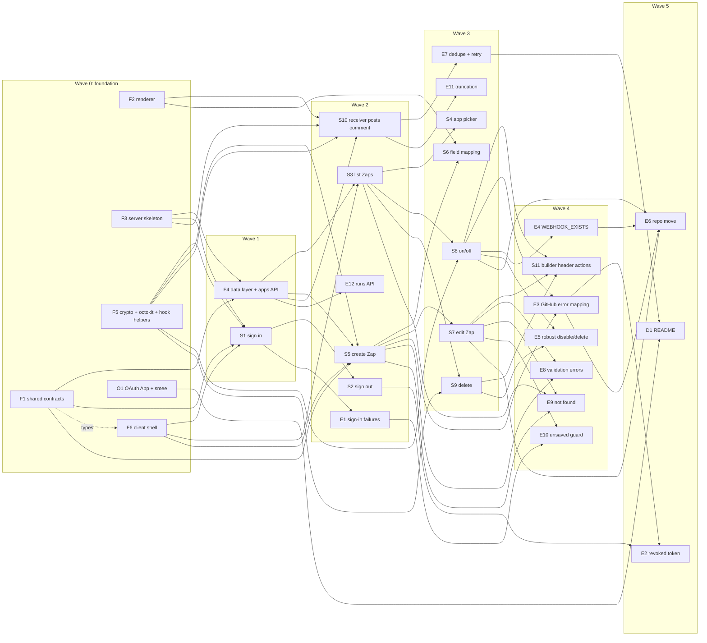

# Zaps: implementation plan

This plan breaks the Zaps first release into **vertical slices**. Each slice delivers one user-visible capability across `/shared`, `/server` and `/client`, and can be tested on its own.

- The spec is [PRD.md](PRD.md), [Tech-Stack.md](Tech-Stack.md), [Data-model.md](Data-model.md), [API.md](API.md) and [Screens.md](Screens.md). This plan adds no new behavior. Where the docs are silent, the gap is listed in [Spec gaps](#spec-gaps).
- The project boilerplate (npm workspaces, Angular 16 CLI app with Material, server package with deps, `docker-compose.yml` with Mongo, `.env.example`) is assumed to exist. It is not a task here.
- Order: a small **foundation** stage, then **happy-path slices** (the main flow can be demoed early), then **edge-case slices** that extend them.

ID prefixes: `F` foundation, `O` manual setup, `S` happy-path slice, `E` edge-case slice, `D` docs.

---

## Summary

| ID | Title | Wave | Depends on | Size |
|---|---|---|---|---|
| F1 | Shared contracts: schemas, DTOs, tokens, apps seed list | 0 | — | M |
| F2 | Shared template renderer (basic) | 0 | — | S |
| F3 | Server skeleton: env, middleware, errors, Mongo, session, test harness | 0 | — | L |
| F5 | Token encryption, Octokit factory, webhook helpers | 0 | — | M |
| F6 | Client shell skeleton: providers, AuthService, guards, interceptor, routes | 0 | F1 (types only) | M |
| O1 | Create the GitHub OAuth App, smee channel and local `.env` | 0 | — | S |
| F4 | Data layer: models, seed script, `GET /api/apps` | 1 | F1, F3 | M |
| S1 | Sign in with GitHub | 1 | F1, F3, F5, F6 | M |
| S2 | Sign out | 2 | S1 | S |
| S3 | List my Zaps | 2 | F4, F6 | M |
| S5 | Create a Zap in the builder | 2 | F1, F4, F5, F6 | L |
| S10 | Webhook receiver posts the PR comment | 2 | F2, F3, F4, F5 | M |
| E1 | Sign-in failures and expired sessions | 2 | S1 | S |
| E12 | Runs API for debugging | 2 | F4 | S |
| S4 | App picker | 3 | S3 | S |
| S6 | Field mapping: insert field, preview, counter | 3 | S5, F2 | S |
| S7 | Edit a Zap | 3 | S5 | M |
| S8 | Turn a Zap on and off (webhook create/remove) | 3 | S3, F4, F5 | M |
| S9 | Delete a Zap | 3 | S3, F5 | S |
| E7 | Receiver: failed runs, duplicate deliveries, retry | 3 | S10 | M |
| E11 | Long and non-ASCII comments (truncation) | 3 | F2, S10 | S |
| S11 | Builder header: on/off toggle and Delete | 4 | S7, S8, S9 | S |
| E3 | GitHub error mapping: `REPO_NOT_ACCESSIBLE`, rate limits, `GITHUB_ERROR` | 4 | S5, S8 | M |
| E4 | Leftover webhook: `409 WEBHOOK_EXISTS` and dialog | 4 | S8 | M |
| E5 | Robust disable/delete and enable guards | 4 | S8, S9 | S |
| E8 | Validation errors mapped to builder fields | 4 | S5, S7 | M |
| E9 | Not found and bad links | 4 | S3, S5, S7 | S |
| E10 | Unsaved-changes guard | 4 | S7, E1 | S |
| E2 | Revoked GitHub token: `GITHUB_AUTH_REQUIRED` and `endSession` | 5 | S2, E3 | M |
| E6 | Repo move on an enabled Zap | 5 | S7, S8, E3, E4 | M |
| D1 | README: setup, smee, seed, tests, "Redeliver" | 5 | O1 (start), E7 (finish) | S |

Totals: 6 foundation tasks (F1–F6), 1 manual setup task (O1), 11 happy-path slices, 12 edge-case slices, 1 docs task. **31 items.**

---

## Dependency graph

### Waves

| Wave | Runs in parallel | Notes |
|---|---|---|
| 0 | F1, F2, F3, F5, F6, O1 | Each owns separate files. F6 can stub DTO types until F1 lands. O1 is manual, no code. |
| 1 | F4, S1 | S1 can start as soon as F1/F3/F5/F6 merge; F4 in parallel. |
| 2 | S2, S3, S5, S10, E1, E12 | Six independent streams. S3/S5/S10 test their server side with F3's `authenticateAs` test option and seeded data; they don't need S1 for automated tests, only for the manual check. |
| 3 | S4, S6, S7, S8, S9, E7, E11 | **First demo is reachable at the end of this wave** (S4, S8). |
| 4 | S11, E3, E4, E5, E8, E9, E10 | E3 and E4 both touch the create-webhook routine; see conflict notes. |
| 5 | E2, E6, D1 | E6 is the last behavior slice. D1 can be drafted from wave 0 and finalized here. |

---

## First demo milestone

The smallest set that runs the full PRD happy path against real GitHub (sign in → create a Zap → turn it on → open a PR on a public repo you admin → the comment appears):

**O1, F1, F2, F3, F4, F5, F6, S1, S3, S4, S5, S8, S10.**

- Done when all of these are merged, which is the end of **wave 3** (S4 and S8 are in wave 3; the rest finish earlier).
- The comment in the demo is a plain string or uses tokens typed by hand. The token itself renders, because the renderer is F2 and S5's server validation already accepts known tokens.
- Add **S6** to show the builder's "some field mapping" UX (Insert field, preview). The PRD lists field mapping as must-have, so S6 belongs in the first release but isn't needed to see the comment appear.
- Not in the demo: S2 sign out, S7 edit, S9 delete, and all `E` slices.

---

## Conflict notes

Files that more than one task touches, and how to keep merges trivial.

| File / area | Touched by | Rule |
|---|---|---|
| `shared/src/index.ts` (barrel) | F1, F2, F3 | Each task adds **one `export * from './<module>'` line** for its own module. Modules are owned by one task each: F1 `schemas/`, `dto.ts`, `tokens.ts`, `apps.seed.ts`; F2 `render.ts`; F3 `errors.ts`. Later slices don't edit the barrel unless they add a module. |
| `server/src/app.ts` (`createApp`) | F3 only | F3 writes the whole middleware chain (API.md → Middleware order). Slices never edit `app.ts`. |
| `server/src/routes/api/index.ts` | F3 creates; F4, S1, S3, S5, S7, S8, S9, E12 register | **One router file per slice, one registration line each.** F3 creates the file with a comment block marking where lines go. |
| Zap routes | S3, S5, S7, S8, S9, E12 | Don't share a `zaps.routes.ts`. Use `server/src/routes/api/zaps/list.ts` (S3), `create.ts` (S5), `get-update.ts` (S7), `toggle.ts` (S8), `delete.ts` (S9), `runs.ts` (E12), each exporting a `Router`, registered in `routes/api/zaps/index.ts` by one line. F4 creates that index file empty. |
| `server/src/routes/auth.ts` | S1, S2, E1 | S1 creates it. S2 adds the logout route at the end of the file; E1 only changes the callback's failure redirect. Keep handlers small and in `server/src/auth/` modules to limit overlap. |
| `server/src/github/webhooks.ts` (`createWebhook`, `removeWebhook`, `buildHookBody`) | F5 creates; E3, E4, E5, E6 extend | F5 writes the happy path. E3 wraps GitHub errors with `mapGithubError` (new file `github/errors.ts`, owned by E3). E4 adds the 422 → list hooks branch in a separate function `findOwnHook` (new file `github/find-own-hook.ts`) and one call site in `createWebhook`. E5 changes only `removeWebhook`. E3 and E4 are in the same wave; whoever merges second rebases one small call site. |
| `server/src/zaps/` helpers (`toZapDto`, `findOwnedZap`) | F4 creates; S3, S5, S7, S8, S9, E12 use | Read-only for slices. If a slice needs a new helper, it adds a new file. |
| `server/src/errors/handler.ts` | F3 creates; E2 extends | E2 adds the `endSession` branch for `GITHUB_AUTH_REQUIRED`. Nobody else edits it; new error types extend `AppError` (F3) with a code from `shared/src/errors.ts`. |
| `client/src/app/app.routes.ts` | F6 creates; E10 adds a guard | F6 declares **every route from Screens.md up front**, each with `loadComponent` pointing at a placeholder standalone component at its final path. Slices replace the component's contents, never the routes file. E10 adds `canDeactivate: [unsavedChangesGuard]` to two routes. |
| `client/src/app/core/http-error.interceptor.ts` and `core/error-messages.ts` | F6 creates; E1, E2 extend | F6 fills the snackbar text for every code from Screens.md → Error handling (strings only). E1 adds the `UNAUTHENTICATED` redirect, E2 the `GITHUB_AUTH_REQUIRED` redirect. Call sites that handle a code themselves (builder `VALIDATION_ERROR`, `WEBHOOK_EXISTS` dialog, builder `NOT_FOUND`) opt out through an `HttpContextToken` F6 provides, so slices don't edit the interceptor. |
| `zaps/zap-list/zap-list.component.*` and `zap-card.component.*` | S3 creates; S4, S8, S9, E9 extend | S3 lays out the **Create Zap** button, the toggle and the ⋮ menu with empty handlers (`onCreate()`, `onToggle()`, `onDelete()`) and `@Output`s on the card. S4, S8, S9 fill one handler each. |
| `zaps/zap-builder/*` | S5 creates; S6, S7, S11, E6, E8, E10 extend | S5 splits the builder into `zap-builder.component` (page + header), `trigger-step.component` and `action-step.component`. S6 touches only `action-step`. S7 adds edit-mode loading to `zap-builder`. S11 touches the header only. E8 adds a form-error mapping helper in its own file. |
| Toggle behavior (list and builder) | S8 creates `ZapToggleService`; S11, E3, E4, E5 use or extend | All toggle calls and error handling go through this one service, so E4's dialog covers the list and the builder at once. |
| `server/package.json` scripts | F4 (seed) | Only F4 adds `"seed"`. The boilerplate already has `dev`, `build`, `test`, `smee`. |

---

## Foundation (wave 0–1)

### F1. Shared contracts: schemas, DTOs, tokens, apps seed list
- **Goal:** Server and client share one source of truth for request validation, response types, placeholder tokens and the app catalog.
- **Scope in:**
  - DTO types: `UserDto`, `AppDto`, `ZapStep`, `ZapDto`, `ZapRunDto`, `RepoDto`, `EncryptedValue`.
  - Step config registry keyed by `app + event`: `github / pull_request.opened` → `{ owner, repo }`; `github / pull_request.comment` → `{ body }` (1–65,536, JS `length`). Unknown pair is rejected.
  - `createZapSchema` (`{ appId, name, trigger, action }`) and `patchZapSchema` (any of those), plus a `validateZap(merged)` function for the merged Zap: config by registry, name 1–100, every `{{token}}` in action string fields is in the trigger's token list. (The `appId ↔ trigger.app` check needs the DB, so the server does it.)
  - Token list for `github / pull_request.opened` (`pr.number`, `pr.title`, `pr.body`, `pr.url`, `pr.author`, `repo.name`, `repo.fullName`) with display labels for the Insert field menu, and an `extractTokens(template)` helper.
  - Objectid-string schema for `?appId=` and path ids.
  - Apps seed list (5 apps: github available; gitlab, jira, linear, slack coming soon) with `key`, `name`, `icon`, `status`, `order`, `triggers`, `actions`.
- **Scope out:** renderer (F2), error codes (F3 owns `errors.ts`), DB-level checks (F4/S5).
- **Touches:** shared: `schemas/`, `dto.ts`, `tokens.ts`, `apps.seed.ts`, barrel line.
- **Depends on:** —
- **Doc refs:** Data-model.md → `zaps` (Trigger / action shape, Field mapping), `apps`, Shared type `EncryptedValue`; API.md → DTOs, Validation (POST and PATCH).
- **Acceptance:**
  - `npm run build -w shared` passes; server and client can import from `@zaps/shared`. With `npm run dev:shared` running, an edit in `/shared` is picked up by `dev:server` and `dev:client` without a restart (Tech-Stack.md → Repository layout).
  - node:test unit tests in shared (run via the server test runner or a shared `test` script): valid/invalid configs per pair, unknown pair rejected, name bounds, body 65,536 OK / 65,537 rejected (UTF-16 length), unknown token rejected, known tokens accepted, `extractTokens` handles adjacent and malformed braces.
- **Size:** M

### F2. Shared template renderer (basic)
- **Goal:** One function turns a comment template plus token values into the comment text, used by the server and the builder preview.
- **Scope in:** `renderTemplate(template, values: Record<string, string>)`: plain `{{token}}` substitution, no expressions. Sample values for the preview (`octocat`, `42`, "Fix login redirect", …). A `buildTokenValues(prPayload)` that maps a `pull_request` payload to token values (`pr.body` → `''` when null).
- **Scope out:** truncation to 65,536 code points (E11).
- **Touches:** shared: `render.ts`, barrel line.
- **Depends on:** — (takes a plain values map, so it doesn't need F1's token list).
- **Doc refs:** Data-model.md → Field mapping; Screens.md → Action card (Preview).
- **Acceptance:** node:test unit tests: all 7 tokens substituted, repeated tokens, text without tokens unchanged, null PR body renders empty.
- **Size:** S

### F3. Server skeleton: env, middleware, errors, Mongo, session, test harness
- **Goal:** A running Express 5 app with the documented middleware order, error envelope and session store, that every server slice plugs routers into.
- **Scope in:**
  - Env loading: `import 'dotenv/config'` as the **first** import of `src/index.ts`, loading `server/.env` (the cwd when run via `npm run … -w server`). Set `DOTENV_CONFIG_QUIET=true` (or `quiet: true`) so dotenv doesn't log on startup. dotenv never overrides variables already set in the environment, so tests set `NODE_ENV=test` and pass the in-memory Mongo URI themselves, never reading `.env`'s `MONGODB_URI`.
  - Replace the boilerplate `smee` script (which reads `SMEE_URL`) with `tsx scripts/smee.ts`: a tiny script that does `import 'dotenv/config'` and starts smee-client's `Client` with `source: WEBHOOK_PUBLIC_URL`, `target: http://localhost:3000/webhooks/github`. Drop the `SMEE_URL` note from `.env.example`.
  - Env validation with zod for all vars in API.md → Configuration; refuse to start on a missing/invalid var (including `TOKEN_ENCRYPTION_KEY` decoding to 32 bytes).
  - Single `mongoose.connect()` promise; startup awaits it before `listen`; `connect-mongo` v5 store with `clientPromise: conn.then(m => m.connection.getClient())`, `ttl` 7 days.
  - `createApp()` with middleware in API.md order: helmet, cors (`CLIENT_URL`, credentials), `/webhooks` mount point (raw), `express.json()`, session (`zaps.sid`, httpOnly, sameSite lax, 7 days), passport initialize/session, `/auth` mount point, `/api` router with `requireAuth` and `requireJson` (POST/PATCH only), 404 handler, error handler.
  - `shared/src/errors.ts`: error code union and envelope type. Server `AppError` class (status, code, message, details). Error handler maps zod errors → `400 VALIDATION_ERROR` with issues, `AppError` → its envelope, anything else → `500 INTERNAL_ERROR` without stack.
  - `requireAuth` → `401 UNAUTHENTICATED`; `requireJson` → `415 UNSUPPORTED_MEDIA_TYPE`.
  - `User` model (`githubId` unique, `login`, `name`, `avatarUrl`, `accessToken` as `EncryptedValue` subdocument, timestamps) and passport `serializeUser`/`deserializeUser` by `_id`.
  - Test harness (see Tech-Stack.md → Testing approach): a helper that starts `mongodb-memory-server`, connects Mongoose and the session store to it, clears collections before each test and stops it after; and `createApp({ authenticateAs })`, a test-only option that sets `req.user` right after `passport.session()` so `requireAuth` passes. The production entry never passes it.
- **Scope out:** OAuth strategy and routes (S1), `endSession` (S2), GitHub error mapping (E3/E2).
- **Touches:** server: `src/index.ts`, `src/app.ts`, `src/env.ts`, `src/db.ts`, `src/errors/*`, `src/middleware/*`, `src/models/user.ts`, `src/routes/api/index.ts`, `src/test/*`; shared: `errors.ts`.
- **Depends on:** —
- **Doc refs:** API.md → Conventions, Errors, Middleware order, Configuration; Tech-Stack.md → Server (express-session, connect-mongo, passport), Database; Data-model.md → `users`, `sessions`.
- **Acceptance (node:test + supertest):**
  - Env: missing var / bad key length → startup function throws.
  - `GET /api/anything` without session → `401` with `UNAUTHENTICATED` envelope.
  - Authenticated `POST` to a test route with `text/plain` → `415`; with JSON → passes. `DELETE` without body passes.
  - Unknown route → `404 NOT_FOUND` envelope. A thrown error → `500 INTERNAL_ERROR`, no stack in body.
  - CORS: preflight from `CLIENT_URL` allowed with credentials; another origin not allowed.
  - Manual: `npm run dev -w server` starts against docker Mongo and refuses to start when a var is removed from `.env`. `index.ts` never passes `authenticateAs`.
- **Size:** L

### F5. Token encryption, Octokit factory, webhook helpers
- **Goal:** Server code can encrypt secrets, talk to GitHub as a user, and create/remove a Zap's webhook, with a seam to mock GitHub in tests.
- **Scope in:**
  - `encrypt(plain) → EncryptedValue` / `decrypt(value)` with AES-256-GCM, random 12-byte IV, base64 fields, key from env.
  - `octokitFor(encryptedToken)`: decrypts in memory and returns an `Octokit`. A test override (`setOctokitFactory(fn)` / reset) so tests inject a fake.
  - `buildHookBody(zapId, secret, webhookPublicUrl)` exactly as API.md; `createWebhook(octokit, { owner, repo, zapId })` → `{ hookId, secret }` (fresh 32-byte secret) for the success path only; `removeWebhook(octokit, { owner, repo, hookId })` for the success path only.
- **Scope out:** GitHub error mapping (E3), 422 leftover-hook lookup (E4), best-effort/404 rules (E5).
- **Touches:** server: `src/crypto/token.ts`, `src/github/octokit.ts`, `src/github/webhooks.ts`.
- **Depends on:** — (reads the key through a function argument or `env.ts`; if `env.ts` isn't merged yet, take the key as a parameter).
- **Doc refs:** Tech-Stack.md → GitHub integration; API.md → Create-webhook routine (hook body only).
- **Acceptance (node:test):** encrypt/decrypt round trip; two encryptions of the same value differ (IV); tampered ciphertext or authTag throws; `buildHookBody` has `content_type: 'json'`, `insecure_ssl: '0'`, `events: ['pull_request']`, `active: true`, URL `…?zap=<id>`; `createWebhook` calls `repos.createWebhook` on the fake with that body and returns its id; secret is 32 random bytes.
- **Size:** M

### F6. Client shell skeleton: providers, AuthService, guards, interceptor, routes
- **Goal:** The Angular app boots into a shell with a toolbar, knows whether the user is signed in, and routes to placeholder screens.
- **Scope in:**
  - `app.config.ts`: `provideRouter`, `provideHttpClient(withInterceptors([httpErrorInterceptor]))`, `provideAnimations`. `environment.ts` already has `apiUrl: 'http://localhost:3000'` (boilerplate). Every request uses `withCredentials: true` (set in the interceptor).
  - `AuthService`: `BehaviorSubject<UserDto | null | undefined>` (unknown / signed out / user), calls `GET /api/me` once and caches; a `401` there is cached as `null`, not an error. `setSignedOut()`.
  - `authGuard` and `guestGuard` (functional).
  - `httpErrorInterceptor`: skips `GET /api/me`; parses the envelope into an `ApiError`; shows a snackbar with the text from `error-messages.ts` for every code in Screens.md → Error handling; network error → "Something went wrong. Try again." Provides an `HttpContextToken` for call sites that handle certain codes themselves. No redirects yet (E1, E2).
  - `NotificationService` wrapping `MatSnackBar`.
  - `ShellComponent` with `mat-toolbar` ("⚡ Zaps" link to `/zaps`) and router outlet; avatar menu placeholder.
  - `app.routes.ts` with all routes from Screens.md → Routes and placeholder components at their final paths; `**` → `/zaps`.
  - `ConfirmDialogComponent` (generic title/message/confirm label), used by S9, S11 and E10.
  - `indigo-pink` theme in `angular.json`/styles.
- **Scope out:** login page content (S1), sign out (S2), `UNAUTHENTICATED`/`GITHUB_AUTH_REQUIRED` redirects (E1/E2), unsaved guard (E10).
- **Touches:** client: `app.config.ts`, `app.routes.ts`, `environments/`, `core/*`, `layout/shell.component.*`, `shared/confirm-dialog.component.*`, placeholder components.
- **Depends on:** F1 for DTO types (can stub until it lands).
- **Doc refs:** Screens.md → Navigation, Routes, App shell, Error handling, Component structure; Tech-Stack.md → Client.
- **Acceptance (Karma/Jasmine):** `AuthService` caches `/api/me` (one request for many subscribers) and maps `401` to `null`; `authGuard` redirects `null` to `/login`; `guestGuard` redirects a user to `/zaps`; interceptor adds `withCredentials`, skips `/api/me`, shows the mapped snackbar text, respects the opt-out token. `ng build` passes. Manual: `ng serve` shows the toolbar on `/zaps` (placeholder).
- **Size:** M

### O1. Create the GitHub OAuth App, smee channel and local `.env`
- **Goal:** A developer has real GitHub credentials and a public webhook URL to run the app locally.
- **Scope in:** Register one GitHub OAuth App (homepage `http://localhost:4200`, callback `http://localhost:3000/auth/github/callback`); create a smee.io channel; generate `SESSION_SECRET` and a 32-byte base64 `TOKEN_ENCRYPTION_KEY`; fill `.env` from `.env.example`; pick or create a **public test repo** you admin.
- **Scope out:** README write-up (D1).
- **Touches:** local `.env` only (not committed).
- **Depends on:** —
- **Doc refs:** Tech-Stack.md → GitHub integration; API.md → Configuration.
- **Acceptance:** Server starts with the env (after F3). The smee URL is reachable. Steps captured for D1.
- **Size:** S

### F4. Data layer: models, seed script, `GET /api/apps`
- **Goal:** The app catalog is in Mongo and served to the client, and Zap/run models with their indexes exist for every slice.
- **Scope in:**
  - `App`, `Zap`, `ZapRun` Mongoose models with timestamps and all indexes from Data-model.md, including the `webhook.hookId` unique index with `partialFilterExpression: { 'webhook.hookId': { $type: 'number' } }`, and the 7-day TTL on `zapRuns.createdAt`.
  - Seed script `npm run seed -w server`: upserts F1's seed list by `key`.
  - Helpers: `toZapDto(doc)` (exposes `id`, never `userId` or `webhook`), `findOwnedZap(userId, id)` (invalid ObjectId or other owner → `404 NOT_FOUND`).
  - `GET /api/apps` sorted by `order` → `AppDto[]`. Client `AppsService` (fetch and cache).
  - Empty `routes/api/zaps/index.ts` for zap slices to register into.
- **Scope out:** any Zap endpoint.
- **Touches:** server: `src/models/{app,zap,zapRun}.ts`, `src/scripts/seed.ts`, `src/zaps/*`, `src/routes/api/apps.ts`, `src/routes/api/zaps/index.ts`, `package.json` (`seed` script); client: `core/apps.service.ts`.
- **Depends on:** F1, F3
- **Doc refs:** Data-model.md → `zaps` (indexes), `zapRuns` (indexes), `apps`; API.md → Apps, IDs.
- **Acceptance:**
  - node:test: seed is idempotent (run twice → 5 apps, `updatedAt` refreshed); two disabled Zaps with `webhook: null` both save (partial index); two Zaps with the same `hookId` fail; `findOwnedZap` returns 404 for another user's Zap and for `abc`; `toZapDto` omits `webhook`/`userId`.
  - supertest: `GET /api/apps` signed in → 5 apps in `order`; signed out → 401.
  - Karma: `AppsService` caches.
  - Manual: `npm run seed -w server`, then check `apps` in mongosh.
- **Size:** M

---

## Happy-path slices

### S1. Sign in with GitHub
- **Goal:** A user clicks "Sign in with GitHub", authorizes the app, and lands on `/zaps` with their avatar in the toolbar.
- **Scope in:**
  - Passport `GitHubStrategy` with `state: true`, scopes `public_repo admin:repo_hook`.
  - `GET /auth/github`, `GET /auth/github/callback`: upsert user by `githubId` (login, name, avatar, encrypted token via F5), `req.login`, redirect to `CLIENT_URL/zaps`.
  - `GET /api/me` → `UserDto`.
  - Client: Login page (`mat-card`, button sets `window.location.href` to `${environment.apiUrl}/auth/github`); shell shows avatar and `login` in the menu.
- **Scope out:** `?error=oauth` / `?error=github_auth` messages and the failure redirect (E1); sign out (S2); revoked token (E2).
- **Touches:** server: `src/auth/github-strategy.ts`, `src/routes/auth.ts`, `src/routes/api/me.ts` + registration; client: `login/login.component.*`, `layout/shell.component.*` (avatar).
- **Depends on:** F1, F3, F5, F6
- **Doc refs:** API.md → Auth (+ sequence diagram), Current user; Data-model.md → `users`; Screens.md → Login, App shell, Routes; Tech-Stack.md → passport, passport-github2.
- **Acceptance:**
  - node:test: the strategy's verify callback (called directly with a fake profile and token) upserts by `githubId`, updates `login` on second sign-in, stores the token encrypted (stored value ≠ plain token, decrypts back).
  - supertest: `GET /auth/github` → 302 to `github.com/login/oauth/authorize` with both scopes and a `state`; `GET /api/me` with `authenticateAs` → `UserDto` with no `accessToken`; without session → 401.
  - Karma: Login button sets `window.location.href` (use a spy/wrapper); shell shows the avatar from `AuthService`.
  - Manual (real GitHub, O1 done): sign in, land on `/zaps`, refresh keeps the session, `users` has one document, `sessions` has one document.
- **Size:** M

### S2. Sign out
- **Goal:** A signed-in user picks **Sign out** in the avatar menu and is back on the login screen with no session.
- **Scope in:** `endSession(req, res)` helper (await `req.logout`, then `req.session.destroy`, then `clearCookie('zaps.sid')`, then respond). `POST /auth/logout` with `requireJson` → `204`. Client menu item calls it with `{}`, sets auth to `null`, navigates to `/login`.
- **Scope out:** using `endSession` for `GITHUB_AUTH_REQUIRED` (E2).
- **Touches:** server: `src/auth/end-session.ts`, `src/routes/auth.ts` (append route); client: `layout/shell.component.*`, `core/auth.service.ts` (`logout()`).
- **Depends on:** S1
- **Doc refs:** API.md → Conventions (Ending a session), Auth (`POST /auth/logout`); Screens.md → App shell.
- **Acceptance:** supertest: logout → 204, `Set-Cookie` clears `zaps.sid`, the session document is gone, next `GET /api/me` with the old cookie → 401; `text/plain` body → 415. Karma: menu click calls the service, then navigates to `/login`. Manual: sign out, back button doesn't show Zaps.
- **Size:** S

### S3. List my Zaps
- **Goal:** A signed-in user sees their Zaps as cards, newest first, with loading, empty and error states.
- **Scope in:**
  - `GET /api/zaps` scoped by `userId`, sorted `updatedAt` desc, optional `?appId=` filter (valid id only; invalid-id 400 is E9).
  - Client Zap list: grid, cards with app icon/name, summary "PR opened in `owner/repo` → Comment on PR" built from `/api/apps` event names and `trigger.config`, `DatePipe mediumDate`, a slide toggle showing `enabled` (not wired), a ⋮ menu (not wired), **Create Zap** button (not wired). Loading spinner, empty state, load error with Retry.
  - Placeholder app icons in `client/src/assets/` matching seed `icon` paths.
- **Scope out:** card click → edit (S7), toggle (S8), delete (S9), Create Zap → picker (S4), list `NOT_FOUND` handling (E9).
- **Touches:** server: `routes/api/zaps/list.ts` + registration; client: `zaps/zap-list/*`, `zaps/zaps.service.ts` (`list()`), `assets/apps/*`.
- **Depends on:** F4, F6
- **Doc refs:** API.md → Zaps (`GET /api/zaps`), Ownership; Screens.md → Zap list; Data-model.md → `zaps` indexes.
- **Acceptance:** supertest: returns only the session user's Zaps (seed two users), sorted by `updatedAt` desc, `?appId=` filters, no `webhook`/`userId` in the body. Karma: renders N cards from mocked services, empty state when `[]`, error state + Retry re-requests. Manual: insert a Zap in mongosh (or after S5) and see the card.
- **Size:** M

### S4. App picker
- **Goal:** Clicking **Create Zap** opens a dialog of apps where only GitHub can be picked, and picking it opens the builder.
- **Scope in:** `AppPickerDialogComponent` (`MatDialog`, tiles from `AppsService` in `order`, coming-soon tiles greyed with badge and `aria-disabled="true"`, not clickable, close with ✕/Esc). Picking an available app closes the dialog and navigates to `/zaps/new?appId=<id>`. Wire **Create Zap** on the list header and empty state.
- **Scope out:** `/zaps/new` with a bad `appId` (E9).
- **Touches:** client: `zaps/app-picker/*`, `zaps/zap-list/zap-list.component.ts` (`onCreate()`).
- **Depends on:** S3 (F4 for `AppsService`)
- **Doc refs:** Screens.md → App picker dialog, Navigation; PRD.md → app picker must-have.
- **Acceptance:** Karma: 5 tiles in order; clicking a coming-soon tile does nothing and it has `aria-disabled`; clicking GitHub navigates with its id; Esc closes. Manual: open from both the empty state and the header.
- **Size:** S

### S5. Create a Zap in the builder
- **Goal:** A user names a Zap, picks one of their admin public repos, writes a comment and saves; the new Zap shows in their list (off).
- **Scope in:**
  - `GET /api/github/repos`: `GET /user/repos?visibility=public&affiliation=owner,collaborator,organization_member&sort=pushed&per_page=100`, all pages, filtered to `permissions.admin === true`, mapped to `RepoDto`.
  - `POST /api/zaps`: zod (F1) + `appId` exists and its `key === trigger.app` → `201 ZapDto`, `enabled: false`, `webhook: null`.
  - Client builder, create mode: header (← back to `/zaps`, name input defaulting to "Untitled Zap", toggle disabled with tooltip, Save), trigger card (read-only app, event preselected, repo `mat-autocomplete` loaded once and filtered client-side, must be picked from the list), action card (event preselected, textarea with `cdkTextareaAutosize`, required, prefilled with `Thanks @{{pr.author}} for opening this pull request!`). Client validation with the shared zod schemas. Save: POST, `markAsPristine()`, then `navigate(['/zaps', id], { replaceUrl: true })`, "Saved" snackbar.
- **Scope out:** Insert field, preview, counter, inline unknown-token error (S6); edit mode (S7); server `VALIDATION_ERROR` → field mapping (E8); repos errors (E3, E2); bad `appId` in URL (E9); unsaved guard (E10).
- **Touches:** server: `routes/api/github-repos.ts`, `github/repos.ts`, `routes/api/zaps/create.ts` + registrations; client: `zaps/zap-builder/*` (new), `zaps/zaps.service.ts` (`create()`), `core/github.service.ts`.
- **Depends on:** F1, F4, F5, F6
- **Doc refs:** API.md → GitHub helpers, Zaps (POST), Validation; Screens.md → Zap builder (Form, Header bar, Trigger card, Action card minus Insert/Preview); Data-model.md → `zaps`.
- **Acceptance:**
  - supertest + **mocked Octokit**: repos endpoint follows pagination (2 pages), drops non-admin repos, keeps GitHub's order; POST valid body → 201 with `enabled: false`; `appId` of `gitlab` with `trigger.app: 'github'` → 400; unknown token → 400; another user can't see it (`GET /api/zaps` as user B).
  - Karma: Save disabled when pristine/invalid; free-text repo is invalid; Save calls POST, then marks pristine, then navigates (order checked with spies).
  - Manual (real GitHub): repo list shows only your admin public repos; save; Zap appears on `/zaps` as Off.
- **Size:** L

### S6. Field mapping: insert field, preview, counter
- **Goal:** While writing the comment, a user can insert PR fields like `{{pr.author}}` and see a live preview with sample data.
- **Scope in:** **+ Insert field** `mat-menu` listing F1 tokens with labels, inserts at the cursor; live Preview using F2 `renderTemplate` with sample values; `n / 65536` counter (JS `length`); client-side "Unknown field {{x}}" error from `extractTokens`.
- **Scope out:** server-side unknown-token error mapped to the field (E8); truncation (E11).
- **Touches:** client: `zaps/zap-builder/action-step.component.*` only.
- **Depends on:** S5, F2
- **Doc refs:** Screens.md → Action card; Data-model.md → Field mapping.
- **Acceptance:** Karma: inserting a token at a cursor position in the middle of text; preview updates on input; counter counts an emoji as 2; `{{nope}}` shows the error and makes the form invalid. Manual: insert `{{pr.title}}`, preview shows "Fix login redirect".
- **Size:** S

### S7. Edit a Zap
- **Goal:** A user opens a saved Zap from the list, changes its name, repo or comment, and saves.
- **Scope in:**
  - `GET /api/zaps/:id` and `PATCH /api/zaps/:id` (top-level merge, validate the merged Zap, `appId ↔ trigger.app`). For a **disabled** Zap, or an enabled Zap whose repo didn't change, just save.
  - Client: card click (outside toggle/menu) → `/zaps/:id`; builder edit mode loads Zap, apps and repos with a spinner; Save sends only changed top-level fields; "Saved" snackbar; form marked pristine.
- **Scope out:** repo change on an enabled Zap and the info banner (E6; until E6 lands, don't change the repo of an enabled Zap, see Spec gap 10); builder toggle and Delete (S11); 404 state (E9); validation mapping (E8); unsaved guard (E10).
- **Touches:** server: `routes/api/zaps/get-update.ts` + registration; client: `zaps/zap-builder/zap-builder.component.*` (edit mode), `zaps/zap-list/zap-card.component.*` (click), `zaps/zaps.service.ts` (`get()`, `update()`).
- **Depends on:** S5
- **Doc refs:** API.md → Zaps (GET/PATCH, Validation); Screens.md → Zap builder (Save edit mode, States initial load), Zap list (card click).
- **Acceptance:** supertest: GET own → 200, other user's → 404; PATCH `name` only keeps trigger/action; PATCH `trigger` replaces the whole step; PATCH that makes the merged Zap invalid (e.g. `trigger.app` mismatch) → 400; `updatedAt` changes. Karma: edit mode loads, PATCH body contains only changed fields. Manual: rename a Zap, list order updates.
- **Size:** M

### S8. Turn a Zap on and off
- **Goal:** Flipping a Zap's toggle on the list creates its GitHub webhook (on) or removes it (off).
- **Scope in:**
  - `POST /api/zaps/:id/enable`: load owned Zap, create webhook with F5 (`?zap=<id>` URL, fresh secret), store `webhook: { hookId, secret: encrypt(secret) }`, `enabled: true` → `ZapDto`.
  - `POST /api/zaps/:id/disable`: remove webhook with F5, set `webhook: null`, `enabled: false`.
  - Client `ZapToggleService` (calls enable/disable, returns the updated Zap or an `ApiError`); list toggle disabled while the request runs, reverts on error (generic snackbar from F6).
- **Scope out:** GitHub error mapping (E3); leftover hook 409 (E4); best-effort removal, already-on/off no-ops, `APP_UNAVAILABLE` (E5); revoked token (E2); builder toggle (S11).
- **Touches:** server: `routes/api/zaps/toggle.ts` + registration; client: `zaps/zap-toggle.service.ts`, `zaps/zap-list/*` (`onToggle()`).
- **Depends on:** S3, F4, F5
- **Doc refs:** API.md → Zaps (Enable, Disable, Create-webhook routine success path, sequence diagram); Data-model.md → Lifecycle rules, state diagram; Tech-Stack.md → GitHub integration.
- **Acceptance:**
  - supertest + **mocked Octokit**: enable calls `createWebhook` with the documented body for `trigger.config.owner/repo`, stores `hookId` and an encrypted secret, response has no `webhook`; disable calls `deleteWebhook` with the stored id and clears `webhook`; another user's Zap → 404.
  - Karma: toggle disabled during request; on success uses the returned `enabled`; on error reverts.
  - Manual (**real repo**): toggle on → hook appears in repo Settings → Webhooks with `?zap=<id>` URL, JSON content type, `pull_request` event, and a green `ping`; toggle off → hook gone.
- **Size:** M

### S9. Delete a Zap
- **Goal:** A user deletes a Zap from the card menu after confirming; its webhook and runs go with it.
- **Scope in:** `DELETE /api/zaps/:id` → remove webhook if present (F5, success path), delete the Zap and its `zapRuns` → `204`. Client ⋮ **Delete** opens `ConfirmDialogComponent` ("Delete *name*? Its GitHub webhook will be removed."), then calls DELETE and removes the card.
- **Scope out:** best-effort removal when GitHub fails (E5); builder Delete (S11); `NOT_FOUND` on a stale card (E9).
- **Touches:** server: `routes/api/zaps/delete.ts` + registration; client: `zaps/zap-list/*` (`onDelete()`), `zaps/zaps.service.ts` (`delete()`).
- **Depends on:** S3, F5
- **Doc refs:** API.md → Zaps (DELETE, Disable/Delete); Data-model.md → Lifecycle rules (deleting deletes `zapRuns`); Screens.md → Zap list (Delete).
- **Acceptance:** supertest + mocked Octokit: deletes Zap and only its runs (another Zap's runs stay); enabled Zap → `deleteWebhook` called; disabled Zap → no GitHub call; other user's → 404. Karma: cancel does nothing; confirm calls DELETE and removes the card; no native `confirm()`. Manual: delete an enabled Zap, hook disappears on GitHub.
- **Size:** S

### S10. Webhook receiver posts the PR comment
- **Goal:** When a PR is opened on a repo with an enabled Zap, the Zap's comment appears on that PR.
- **Scope in:**
  - `POST /webhooks/github` with `express.raw({ type: 'application/json' })`, mounted before `express.json()` (F3 mount point).
  - Find Zap by `X-GitHub-Hook-ID`; unknown hook or disabled Zap → `204`.
  - Signature: header must match `sha256=` + 64 hex, else `401`; HMAC-SHA256 with the decrypted secret; length check, then `timingSafeEqual`; mismatch → `401`.
  - Not `pull_request` + `opened` (including `ping`) → `204`.
  - Insert `zapRun` (`pending`, `deliveryId`, `input: { prNumber, prUrl }`), render the body with F2 (`buildTokenValues`), post the comment with the owner's token, set `success` + `output.commentUrl` → `200`.
- **Scope out:** comment failure → `failed` run, duplicate delivery, retry of failed runs, stuck pending (E7); truncation (E11); runs API (E12).
- **Touches:** server: `routes/webhooks.ts`, `webhooks/verify-signature.ts`, `webhooks/handle-pull-request.ts`.
- **Depends on:** F2, F3, F4, F5
- **Doc refs:** API.md → Webhook receiver; Data-model.md → `zapRuns` (sequence diagram, happy branch); Tech-Stack.md → smee-client.
- **Acceptance:**
  - supertest + **mocked Octokit** (test inserts a Zap with an encrypted secret and `hookId`, signs a JSON fixture with that secret): valid `opened` → 200, one `success` run, `issues.createComment` called with the PR number and rendered body; bad signature → 401, no run; malformed header → 401; unknown hook id → 204; disabled Zap → 204; `ping` and `pull_request.closed` → 204, no run.
  - Unit: signature verify rejects wrong length without throwing.
  - Manual (**real repo + smee**, after S8): run `npm run smee`, open a PR on the test repo, the comment appears; one `success` run in `zapRuns`.
- **Size:** M

### S11. Builder header: on/off toggle and Delete
- **Goal:** From the builder a user can turn the Zap on or off and delete it, without going back to the list.
- **Scope in:** Header toggle via `ZapToggleService`, disabled in create mode and while the form is dirty, with tooltip "Save your changes before turning this Zap on/off"; revert on error. ⋮ menu (edit mode only) with Delete → confirm dialog → DELETE → `/zaps`.
- **Scope out:** `WEBHOOK_EXISTS` dialog (E4, which lands in `ZapToggleService` and covers this toggle automatically).
- **Touches:** client: `zaps/zap-builder/zap-builder.component.*` (header).
- **Depends on:** S7, S8, S9
- **Doc refs:** Screens.md → Header bar (toggle, ⋮ menu).
- **Acceptance:** Karma: toggle disabled in create mode and when dirty (tooltip present); enabled when pristine in edit mode; Delete confirms then navigates. Manual: turn on from the builder, hook appears on GitHub.
- **Size:** S

---

## Edge-case slices

### E1. Sign-in failures and expired sessions
- **Goal:** A user whose sign-in fails sees a clear message, and a user whose session expired is sent back to login instead of seeing errors.
- **Scope in:** Callback failure, denial or `state` mismatch → redirect `CLIENT_URL/login?error=oauth`; login shows "Sign-in failed. Please try again." Interceptor on `UNAUTHENTICATED`: set auth `null`, navigate to `/login` with `{ state: { authRedirect: true } }`.
- **Scope out:** `GITHUB_AUTH_REQUIRED` (E2).
- **Touches:** server: `routes/auth.ts` (failure redirect); client: `login/*`, `core/http-error.interceptor.ts`.
- **Depends on:** S1
- **Doc refs:** API.md → Auth (callback failure); Screens.md → Login (`?error=oauth`), Error handling (`UNAUTHENTICATED`), Unsaved changes (authRedirect state).
- **Acceptance:** supertest: callback with a mismatched/missing `state` → 302 to `/login?error=oauth`; callback with `error=access_denied` → same. Karma: login shows the message only with the query param; interceptor on a 401 `UNAUTHENTICATED` sets `null` and navigates with `authRedirect`. Manual: delete the session in mongosh, click anything → login.
- **Size:** S

### E2. Revoked GitHub token: `GITHUB_AUTH_REQUIRED` and `endSession`
- **Goal:** A user whose GitHub token was revoked is signed out and told to sign in again, instead of seeing GitHub errors.
- **Scope in:** E3's mapper turns GitHub `401` into a `GithubAuthRequiredError`; the error handler calls `endSession` before sending `401 GITHUB_AUTH_REQUIRED` (repos list, enable, PATCH repo move). Disable/delete swallow it (E5) and don't end the session. Client interceptor: set auth `null`, navigate to `/login?error=github_auth` with `authRedirect` state; login shows "Your GitHub session expired, please sign in again".
- **Scope out:** receiver comment `401` (recorded as `failed` in E7; no session to end).
- **Touches:** server: `errors/handler.ts`; client: `core/http-error.interceptor.ts`, `login/*`.
- **Depends on:** S2 (`endSession`), E3 (mapper)
- **Doc refs:** API.md → Errors (`GITHUB_AUTH_REQUIRED`), Conventions (Ending a session), Disable/Delete (401 rule); Screens.md → Login, Error handling; Data-model.md → Revoked tokens.
- **Acceptance:** supertest + mocked Octokit throwing 401: `GET /api/github/repos` → 401 `GITHUB_AUTH_REQUIRED`, cookie cleared, session gone, next `/api/me` → 401; enable → same; disable with 401 from GitHub → 200 and session still valid. Karma: interceptor navigation and login message. Manual (**real GitHub**): revoke the app in GitHub Settings → Applications, open the builder → back on login with the message.
- **Size:** M

### E3. GitHub error mapping: `REPO_NOT_ACCESSIBLE`, rate limits, `GITHUB_ERROR`
- **Goal:** When GitHub refuses an action, the user sees the right explanation (no access vs. GitHub trouble).
- **Scope in:** `mapGithubError(err)` in `github/errors.ts`: `401` → `GithubAuthRequiredError` (behavior in E2); `403` with `retry-after` or `x-ratelimit-remaining: 0` → `502 GITHUB_ERROR`; other `403` and `404` → `422 REPO_NOT_ACCESSIBLE` (create-webhook only); anything else → `502 GITHUB_ERROR`. Applied in `createWebhook` (enable) and the repos list. Client snackbars already exist in F6; verify texts.
- **Scope out:** the `422` leftover-hook branch (E4); disable/delete removal errors (E5).
- **Touches:** server: `github/errors.ts` (new), `github/webhooks.ts` (wrap call), `github/repos.ts` (wrap call).
- **Depends on:** S5, S8
- **Doc refs:** API.md → Errors table, Create-webhook routine step 4; Screens.md → Error handling (`REPO_NOT_ACCESSIBLE`, `GITHUB_ERROR`).
- **Acceptance:** node:test unit on the mapper with fake Octokit `RequestError`s for each case (403+`retry-after`, 403+remaining 0, plain 403, 404, 500, network). supertest + mocked Octokit: enable on 404 → 422 `REPO_NOT_ACCESSIBLE` and Zap stays disabled with `webhook: null`; rate-limit 403 → 502. Manual (**real GitHub**): save a Zap on a repo you don't admin (edit `trigger.config` in mongosh), turn it on → snackbar text.
- **Size:** M

### E4. Leftover webhook: `409 WEBHOOK_EXISTS` and dialog
- **Goal:** If this Zap's old webhook is still on the repo, the user gets a dialog with a link to delete it on GitHub.
- **Scope in:** In `createWebhook`, on GitHub `422`: list `GET /repos/{owner}/{repo}/hooks?per_page=100` across all pages, look for `config.url === <this Zap's URL>`. Found → `409 WEBHOOK_EXISTS` with `details.hookSettingsUrl = https://github.com/{owner}/{repo}/settings/hooks/{id}`; the server doesn't touch that hook. No match or list failure → `502 GITHUB_ERROR`. Client: `ZapToggleService` opts out of the generic snackbar for this code and opens a `MatDialog` (toggle text from Screens.md, **Open webhook on GitHub** with `target="_blank" rel="noopener"`, **Close**); toggle reverts to off. Works on the list and the builder.
- **Scope out:** the Save-variant dialog text for repo moves (E6 reuses this dialog with a different message).
- **Touches:** server: `github/find-own-hook.ts` (new), `github/webhooks.ts` (one call site); client: `zaps/webhook-exists-dialog.component.*` (new, message passed in), `zaps/zap-toggle.service.ts`.
- **Depends on:** S8
- **Doc refs:** API.md → Errors (`WEBHOOK_EXISTS`), Create-webhook routine steps 2–3, enable sequence diagram; Data-model.md → Lifecycle rules; Screens.md → Error handling (`WEBHOOK_EXISTS`).
- **Acceptance:** supertest + mocked Octokit: create → 422, list returns the matching hook on **page 2** → 409 with the right URL, Zap stays disabled; list with no match → 502; list call fails → 502; a hook for a *different* Zap id on the same repo doesn't match. Karma: dialog opens with the link and toggle reverts. Manual (**real repo**): turn a Zap on, delete its document's `webhook` in mongosh and set `enabled: false` (simulating a failed removal), turn on again → dialog; delete the hook on GitHub → turning on works.
- **Size:** M

### E5. Robust disable/delete and enable guards
- **Goal:** A user can always turn off or delete a Zap even when GitHub fails, and repeated or invalid toggles behave predictably.
- **Scope in:** `removeWebhook` best-effort: GitHub `404` counts as removed; any other failure (including `401`) is swallowed (no session end) and local state wins for disable and delete. Enable on an already-enabled Zap → no-op `200` with no GitHub call; disable on a disabled Zap → no-op `200`. Enable when the Zap's app is `coming_soon` → `422 APP_UNAVAILABLE` (snackbar text from F6).
- **Scope out:** —
- **Touches:** server: `github/webhooks.ts` (`removeWebhook` only), `routes/api/zaps/toggle.ts`, `routes/api/zaps/delete.ts`.
- **Depends on:** S8, S9
- **Doc refs:** API.md → Disable/Delete, Enable (no-op, `APP_UNAVAILABLE`); Data-model.md → Lifecycle rules.
- **Acceptance:** supertest + mocked Octokit: disable with GitHub 404 / 500 / 401 → 200 `enabled: false`, `webhook: null`, session intact; delete with 500 → 204 and runs gone; double enable → one `createWebhook` call; Zap with a `coming_soon` `appId` (inserted directly) → 422. Manual (**real repo**): delete the hook on GitHub first, then turn the Zap off → no error.
- **Size:** S

### E6. Repo move on an enabled Zap
- **Goal:** A user can change the repo of a Zap that is on, and its webhook moves to the new repo.
- **Scope in:** PATCH on an enabled Zap whose `trigger.config` repo changes: (1) create the new hook with the create-webhook routine (E3 mapping, E4 409); (2) save Zap + new `webhook`; (3) remove the old hook best-effort (E5). Step 1 fails → nothing changes, error returned. Step 2 fails → remove the new hook best-effort, `500`. Builder: info banner "This Zap is on. Saving changes to the repository moves its webhook."; on `409` show the dialog with the Save text, keep the form dirty and its values.
- **Scope out:** —
- **Touches:** server: `routes/api/zaps/get-update.ts` (or a new `zaps/move-webhook.ts` it calls); client: `zaps/zap-builder/zap-builder.component.*`.
- **Depends on:** S7, S8, E3, E4
- **Doc refs:** API.md → Side effects (PATCH on an enabled Zap); Data-model.md → Lifecycle rules (repo move order); Screens.md → States (banner), Error handling (`WEBHOOK_EXISTS` Save variant).
- **Acceptance:** supertest + mocked Octokit: order of calls is create-new → save → delete-old; create-new 409/422/502 → Zap unchanged in DB, old hook not deleted; save failure (stub `Zap.save` to throw) → new hook deleted, 500; old-hook removal failure → still 200. Changing only the comment on an enabled Zap → no GitHub calls. Karma: banner shown only when enabled; 409 opens the Save dialog and the form stays dirty. Manual (**real repos + smee**): move from repo A to B, open a PR on B → comment; a PR on A → nothing.
- **Size:** M

### E7. Receiver: failed runs, duplicate deliveries, retry
- **Goal:** A PR never gets the same comment twice from one delivery, and a failed comment can be retried with GitHub's "Redeliver".
- **Scope in:** Comment post fails → run `failed` with `error`, receiver still `200` (never `5xx`). Duplicate key on `deliveryId` → atomic `findOneAndUpdate({ deliveryId, status: 'failed' }, { status: 'pending', error: null })`; matched → continue and post; not matched (`success` or `pending`) → `200` skip. Stuck `pending` is never retried.
- **Scope out:** README "Redeliver" steps (D1).
- **Touches:** server: `webhooks/handle-pull-request.ts`.
- **Depends on:** S10
- **Doc refs:** Data-model.md → `zapRuns` (sequence diagram, Deduplication, Retrying a failed run, Stuck pending, Response timing); API.md → Webhook receiver (responses).
- **Acceptance:** supertest + mocked Octokit: comment throws → 200, run `failed` with message; same delivery again after a `success` → 200, no second comment; after `failed` → comment posted, run `success`; a `pending` run + redelivery → 200, no comment; two concurrent identical deliveries (`Promise.all`) → exactly one `createComment` call. Manual (**real repo + smee**): revoke nothing, just use GitHub's Redeliver on a successful delivery → no duplicate comment; break the token (e.g. revoke) → failed run, restore by signing in again, Redeliver → comment appears.
- **Size:** M

### E8. Validation errors mapped to builder fields
- **Goal:** When the server rejects a Zap, the user sees the error on the field that caused it.
- **Scope in:** Builder Save/PATCH opt out of the generic snackbar for `VALIDATION_ERROR`; map `details[].path` (zod issues) to form controls (`name`, `trigger.config.repo`, `action.config.body`, …) as field errors; unmapped paths → snackbar with `message`. Server tests covering each validation rule end to end, plus `415` on the zap routes.
- **Scope out:** client-side zod checks (already in S5/S6).
- **Touches:** client: `zaps/zap-builder/form-errors.ts` (new), `zap-builder.component.ts` (call it); server: tests only.
- **Depends on:** S5, S7
- **Doc refs:** API.md → Errors (`VALIDATION_ERROR`), Validation; Screens.md → Error handling (`VALIDATION_ERROR`), Form.
- **Acceptance:** supertest: POST/PATCH with name of 101 chars, empty body, body 65,537 chars, unknown token, unknown `app + event`, `appId` mismatch → 400 with `details[].path`; `text/plain` → 415. Karma: a 400 with `path: ['action','config','body']` sets an error on that control; unknown path → snackbar.
- **Size:** M

### E9. Not found and bad links
- **Goal:** Stale or mistyped links lead the user somewhere sensible instead of a broken screen.
- **Scope in:** Builder edit mode `NOT_FOUND` → "Zap not found" state with a link to `/zaps`. List actions (toggle/delete) on `NOT_FOUND` → snackbar "This Zap no longer exists", then reload. `/zaps/new` with missing/unknown `appId` or a `coming_soon` app → `/zaps` + snackbar. Server: invalid ObjectId in path → 404; `?appId=abc` → 400 `VALIDATION_ERROR`.
- **Scope out:** —
- **Touches:** client: `zaps/zap-builder/zap-builder.component.*`, `zaps/zap-list/zap-list.component.ts`; server: `routes/api/zaps/list.ts` (query validation), tests.
- **Depends on:** S3, S5, S7
- **Doc refs:** API.md → IDs, `GET /api/zaps?appId=`; Screens.md → Routes, States (404), Error handling (`NOT_FOUND`).
- **Acceptance:** supertest: `GET/PATCH/DELETE/enable /api/zaps/abc` → 404; `?appId=abc` → 400. Karma: builder shows the not-found state; `/zaps/new?appId=<gitlab id>` navigates to `/zaps` with a snackbar; list reloads after a 404 on toggle.
- **Size:** S

### E10. Unsaved-changes guard
- **Goal:** A user who leaves the builder with unsaved edits is asked before losing them.
- **Scope in:** `unsavedChangesGuard` (`CanDeactivateFn`) on `/zaps/new` and `/zaps/:id`: dirty form → `ConfirmDialogComponent` "Discard unsaved changes?" with **Keep editing** / **Discard**; navigations with `state.authRedirect` pass without asking. No `beforeunload`.
- **Scope out:** —
- **Touches:** client: `zaps/zap-builder/unsaved-changes.guard.ts`, `app.routes.ts` (two lines).
- **Depends on:** S7, E1 (the `authRedirect` state)
- **Doc refs:** Screens.md → Unsaved changes, Header bar (Save order), Routes.
- **Acceptance:** Karma: clean form → allowed; dirty + Keep editing → blocked; dirty + Discard → allowed; dirty + `authRedirect` → allowed with no dialog; after create-mode Save no dialog appears (pristine before navigate). Manual: edit, click ←, dialog appears.
- **Size:** S

### E11. Long and non-ASCII comments (truncation)
- **Goal:** A comment never fails because a long PR description made it too long, and non-ASCII PR titles work.
- **Scope in:** F2 renderer truncates the **rendered** output to 65,536 code points (`Array.from`), last char replaced by `…` when cut, never splitting a surrogate pair. Manual check of the smee caveat with a non-ASCII/emoji PR title.
- **Scope out:** —
- **Touches:** shared: `render.ts`; server: test only.
- **Depends on:** F2 (code), S10 (manual check)
- **Doc refs:** Data-model.md → Field mapping (truncation paragraphs); Tech-Stack.md → smee-client caveat.
- **Acceptance:** node:test: output of exactly 65,536 code points is unchanged; 65,537 → 65,536 ending in `…`; an emoji at the cut isn't split; template under the limit + long `{{pr.body}}` gets truncated. supertest: receiver with a 70k-char PR body posts a ≤ 65,536-code-point comment (needs the raw body limit raised; see Spec gaps). Manual (**real repo + smee**): open a PR titled with emoji and accents; if the signature check fails, note it in D1 and switch tunnel. Never weaken the check.
- **Size:** S

### E12. Runs API for debugging
- **Goal:** A developer can see a Zap's last 50 runs through the API to debug failed comments.
- **Scope in:** `GET /api/zaps/:id/runs` → `ZapRunDto[]`, `createdAt` desc, limit 50, owner-scoped.
- **Scope out:** any run history UI (out of scope for this release).
- **Touches:** server: `routes/api/zaps/runs.ts` + registration.
- **Depends on:** F4
- **Doc refs:** API.md → Zaps (runs); Data-model.md → `zapRuns`, Revoked tokens.
- **Acceptance:** supertest: 60 runs → 50 newest in order; other user's Zap → 404; DTO fields only. Manual: `curl` with the session cookie after a demo PR.
- **Size:** S

---

## Docs

### D1. README: setup, smee, seed, tests, "Redeliver"
- **Goal:** A new developer can clone, configure and run the app, and knows how to retry a failed comment.
- **Scope in:** Prereqs (Node 18.20 via `.nvmrc`, Docker); create the GitHub OAuth App (O1 steps, scopes, callback URL); smee channel and `npm run smee`; `.env` (how to generate `TOKEN_ENCRYPTION_KEY` and `SESSION_SECRET`); `docker compose up`, `npm run seed -w server`, dev commands (three terminals: `dev:shared`, `dev:server`, `dev:client`, plus `smee`); running tests (and the test DB); limits (public repos, admin rights, org OAuth restrictions); **Redeliver** steps (repo Settings → Webhooks → the hook → Recent Deliveries → Redeliver) and when it helps (failed runs only); leftover hooks and how to delete them; the smee non-ASCII caveat.
- **Scope out:** editing the existing spec `.md` files.
- **Touches:** root `README.md` (the Angular CLI also generated `client/README.md`; leave or replace it, decide in D1).
- **Depends on:** O1 to start; E7 and E11 to finalize.
- **Doc refs:** Data-model.md → Retrying a failed run ("the step goes in the project README"); Tech-Stack.md → smee-client, GitHub integration; API.md → Configuration.
- **Acceptance:** Someone following only the README on a clean machine reaches the first-demo flow.
- **Size:** S
- **Status:** Drafted as root `README.md` before implementation, with a status note listing the commands that land later (seed: F4; smee reading `.env`: F3). Finalize after F3, F4, E7 and E11: remove the status note and check every step on a clean machine. `client/README.md` (Angular CLI) is kept.

---

## Spec gaps

Things the docs don't settle. Each lists what this plan assumes; confirm before or during the relevant slice.

**Testing**
1. ~~**Test database.**~~ Decided: `mongodb-memory-server` v10 (MongoDB 7.0.24 binary), started per test file (Tech-Stack.md → Testing approach).
2. ~~**Signing in during tests.**~~ Decided: stub auth via `createApp({ authenticateAs })`, which sets `req.user` after `passport.session()`. The real session cookie and OAuth flow aren't exercised by automated tests; S1, S2 and E2 test their handlers directly and add a manual check.
3. ~~**Mocking GitHub.**~~ Decided: one swappable `getOctokit(token)` factory; tests replace it with a fake (Tech-Stack.md → Testing approach, F5).
4. ~~**`node --test` glob on Node 18.**~~ Resolved in the boilerplate: the server `test` script is `find src -name "*.test.ts" -exec node --import tsx --test {} +`, which doesn't rely on glob expansion. (This gap was written from an intermediate version of the script.)
5. ~~**Shared package tests.**~~ Decided: `shared` has its own `test` script (same `find … node --import tsx --test` as the server, `tsx` in its devDependencies), and root `npm test` runs it first. Test files are excluded from the `shared` build. Done in the boilerplate.
6. ~~**`shared/package.json` has no `zod` dependency**~~ Decided and done: `zod ^3.25` added to `shared`'s dependencies (deduped with the server's).

**Server behavior**

7. ~~**Body size limits.**~~ Decided: keep the Express 100 KB defaults for both parsers. Over-limit bodies return `413 PAYLOAD_TOO_LARGE` (API.md → Errors, Conventions → Body size); the builder shows a "too long" snackbar (Screens.md). Accepted limitation: very long non-ASCII templates are rejected, and very large PR payloads aren't processed. F3's error handler maps body-parser's `entity.too.large` to the envelope; add an acceptance test (POST > 100 KB → `413` envelope).
8. ~~**GitHub error mapping outside the create-webhook routine.**~~ Decided as assumed (API.md → GitHub helpers): GitHub `401` → `GITHUB_AUTH_REQUIRED`, anything else → `502 GITHUB_ERROR`.
9. ~~**What counts as a "repo change"**~~ Decided as assumed: case-insensitive compare on `owner` and `repo` (API.md → Side effects).
10. ~~**S7 before E6.**~~ Decided as assumed: E6 must land before anyone relies on editing the repo of an enabled Zap; S7's tests use disabled Zaps only.
11. ~~**Concurrent enable requests**~~ Decided as assumed, no lock. Recorded as an accepted risk in API.md → Enable: the second request can show `409 WEBHOOK_EXISTS` for the live hook.
12. ~~**Form-encoded deliveries.**~~ Decided as assumed: `401`, documented in API.md → Webhook receiver.
13. ~~**`POST /auth/logout` without a session.**~~ Decided as assumed: `204` (API.md → Auth).
14. ~~**Unknown route envelope.**~~ Decided as assumed: `404 NOT_FOUND` (API.md → Middleware order).
15. ~~**Avatar source.**~~ Decided as assumed: `profile._json.avatar_url` (Data-model.md → `users`).
16. ~~**`SMEE_URL` vs `WEBHOOK_PUBLIC_URL`.**~~ Decided: one variable, `WEBHOOK_PUBLIC_URL`; `SMEE_URL` goes away. F3 replaces the `smee` script with `server/scripts/smee.ts` (dotenv + smee-client's `Client`).

**Client behavior**

17. ~~**Default comment body**~~ Decided: prefilled with `Thanks @{{pr.author}} for opening this pull request!`, editable (Screens.md → Action card). In create mode Save only waits for a repo.
18. ~~**Repo list fails to load in the builder**~~ Decided as assumed: the interceptor's usual snackbar and an empty autocomplete; no inline error or retry (Screens.md → Trigger card).
19. ~~**Saved repo no longer in the repo list**~~ Decided as assumed, plus a hint under the field: "This repo isn't in your list anymore; you may have lost admin access." (Screens.md → Trigger card).
20. ~~**Card summary wording.**~~ Decided as assumed: built from the `/api/apps` event names, e.g. "Pull request opened in acme/api → Comment on the pull request". Screens.md sketch updated.
21. ~~**Seed content.**~~ Decided: seed list in Data-model.md → `apps` (GitHub available with one trigger and one action; GitLab, Jira, Linear, Slack coming soon with empty lists, `order` 1–5).
22. ~~**App icons.**~~ Decided: placeholder SVGs at `client/src/assets/apps/<key>.svg` (colored rounded square with initials), swappable later (Data-model.md → `apps`).
23. ~~**Login button URL.**~~ Decided: `${environment.apiUrl}/auth/github` (the boilerplate's key is `apiUrl`).
24. ~~**Error-handling plumbing.**~~ Decided as assumed: `HANDLED_ERROR_CODES` `HttpContextToken` (Screens.md → Error handling).

**Implied tasks the docs don't list**

25. Creating the GitHub OAuth App and a smee channel (O1).
26. A README with setup, seed, smee and **Redeliver** steps (D1; Data-model.md says it "goes in the project README").
27. A public test repo you admin for the manual checks (O1).
28. Placeholder app icons (S3).

---

## Out of scope (not tasks)

Deferred by the docs. Do not build these in this release.

- **Run history UI.** Runs are stored and available through `GET /api/zaps/:id/runs` (E12), but no screen shows them (Screens.md → Out of scope).
- **App filter on the Zap list.** `appId` and the `?appId=` query exist for later (Screens.md → Zap list, Out of scope).
- **Changing a Zap's starting app** in the builder.
- **Copilot** (natural-language Zap drafting) and its LLM provider (PRD.md → Nice-to-have; Tech-Stack.md → Deferred).
- Marketplace, other apps that actually run, billing, teams, multi-step Zaps, private repositories (PRD.md → Out of scope).
- Deployment (the app runs locally only).
