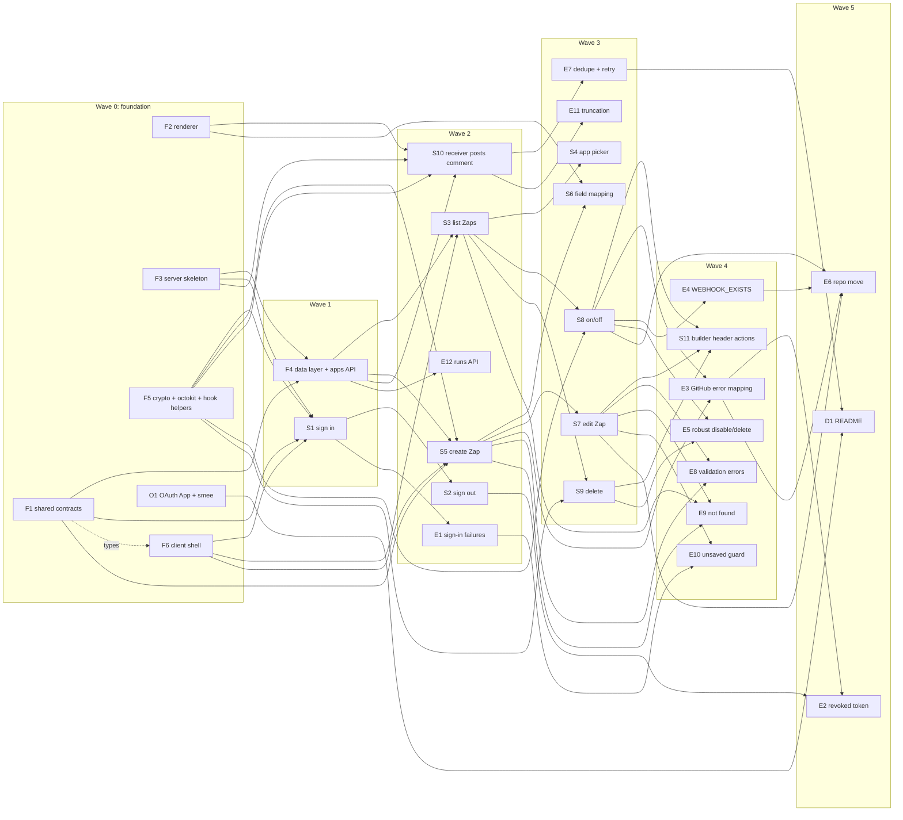

# Zaps: implementation plan

This plan breaks the Zaps first release into **vertical slices**. Each slice delivers one user-visible capability across `/shared`, `/server` and `/client`, and can be tested on its own.

- The spec is [PRD.md](PRD.md), [Tech-Stack.md](Tech-Stack.md), [Data-model.md](Data-model.md), [API.md](API.md) and [Screens.md](Screens.md). This plan adds no new behavior. Where the docs are silent, the gap is listed in [Spec gaps](#spec-gaps).
- The project boilerplate (npm workspaces, Angular 16 CLI app with Material, server package with deps, `docker-compose.yml` with Mongo, `.env.example`) is assumed to exist. It is not a task here.
- Order: a small **foundation** stage, then **happy-path slices** (the main flow can be demoed early), then **edge-case slices** that extend them.

ID prefixes: `F` foundation, `O` manual setup, `S` happy-path slice, `E` edge-case slice, `D` docs.

---

## Summary

| ID | Title | Wave | Depends on | Size |
|---|---|---|---|---|
| F1 | Shared contracts: schemas, DTOs, tokens, apps seed list | 0 | — | M |
| F2 | Shared template renderer (basic) | 0 | — | S |
| F3 | Server skeleton: env, middleware, errors, Mongo, session, test harness | 0 | — | L |
| F5 | Token encryption, Octokit factory, webhook helpers | 0 | — | M |
| F6 | Client shell skeleton: providers, AuthService, guards, interceptor, routes | 0 | F1 (types only) | M |
| O1 | Create the GitHub OAuth App, smee channel and local `.env` | 0 | — | S |
| F4 | Data layer: models, seed script, `GET /api/apps` | 1 | F1, F3 | M |
| S1 | Sign in with GitHub | 1 | F1, F3, F5, F6 | M |
| S2 | Sign out | 2 | S1 | S |
| S3 | List my Zaps | 2 | F4, F6 | M |
| S5 | Create a Zap in the builder | 2 | F1, F4, F5, F6 | L |
| S10 | Webhook receiver posts the PR comment | 2 | F2, F3, F4, F5 | M |
| E1 | Sign-in failures and expired sessions | 2 | S1 | S |
| E12 | Runs API for debugging | 2 | F4 | S |
| S4 | App picker | 3 | S3 | S |
| S6 | Field mapping: insert field, preview, counter | 3 | S5, F2 | S |
| S7 | Edit a Zap | 3 | S5 | M |
| S8 | Turn a Zap on and off (webhook create/remove) | 3 | S3, F4, F5 | M |
| S9 | Delete a Zap | 3 | S3, F5 | S |
| E7 | Receiver: failed runs, duplicate deliveries, retry | 3 | S10 | M |
| E11 | Long and non-ASCII comments (truncation) | 3 | F2, S10 | S |
| S11 | Builder header: on/off toggle and Delete | 4 | S7, S8, S9 | S |
| E3 | GitHub error mapping: `REPO_NOT_ACCESSIBLE`, rate limits, `GITHUB_ERROR` | 4 | S5, S8 | M |
| E4 | Leftover webhook: `409 WEBHOOK_EXISTS` and dialog | 4 | S8 | M |
| E5 | Robust disable/delete and enable guards | 4 | S8, S9 | S |
| E8 | Validation errors mapped to builder fields | 4 | S5, S7 | M |
| E9 | Not found and bad links | 4 | S3, S5, S7 | S |
| E10 | Unsaved-changes guard | 4 | S7, E1 | S |
| E2 | Revoked GitHub token: `GITHUB_AUTH_REQUIRED` and `endSession` | 5 | S2, E3 | M |
| E6 | Repo move on an enabled Zap | 5 | S7, S8, E3, E4 | M |
| D1 | README: setup, smee, seed, tests, "Redeliver" | 5 | O1 (start), E7 (finish) | S |

Totals: 6 foundation tasks (F1–F6), 1 manual setup task (O1), 11 happy-path slices, 12 edge-case slices, 1 docs task. **31 items.**

---

## Dependency graph

### Waves

| Wave | Runs in parallel | Notes |
|---|---|---|
| 0 | F1, F2, F3, F5, F6, O1 | Each owns separate files. F6 can stub DTO types until F1 lands. O1 is manual, no code. |
| 1 | F4, S1 | S1 can start as soon as F1/F3/F5/F6 merge; F4 in parallel. |
| 2 | S2, S3, S5, S10, E1, E12 | Six independent streams. S3/S5/S10 test their server side with F3's `authenticateAs` test option and seeded data; they don't need S1 for automated tests, only for the manual check. |
| 3 | S4, S6, S7, S8, S9, E7, E11 | **First demo is reachable at the end of this wave** (S4, S8). |
| 4 | S11, E3, E4, E5, E8, E9, E10 | E3 and E4 both touch the create-webhook routine; see conflict notes. |
| 5 | E2, E6, D1 | E6 is the last behavior slice. D1 can be drafted from wave 0 and finalized here. |

---

## First demo milestone

The smallest set that runs the full PRD happy path against real GitHub (sign in → create a Zap → turn it on → open a PR on a public repo you admin → the comment appears):

**O1, F1, F2, F3, F4, F5, F6, S1, S3, S4, S5, S8, S10.**

- Done when all of these are merged, which is the end of **wave 3** (S4 and S8 are in wave 3; the rest finish earlier).
- The comment in the demo is a plain string or uses tokens typed by hand. The token itself renders, because the renderer is F2 and S5's server validation already accepts known tokens.
- Add **S6** to show the builder's "some field mapping" UX (Insert field, preview). The PRD lists field mapping as must-have, so S6 belongs in the first release but isn't needed to see the comment appear.
- Not in the demo: S2 sign out, S7 edit, S9 delete, and all `E` slices.

---

## Conflict notes

Files that more than one task touches, and how to keep merges trivial.

| File / area | Touched by | Rule |
|---|---|---|
| `shared/src/index.ts` (barrel) | F1, F2, F3 | Each task adds **one `export * from './<module>'` line** for its own module. Modules are owned by one task each: F1 `schemas/`, `dto.ts`, `tokens.ts`, `apps.seed.ts`; F2 `render.ts`; F3 `errors.ts`. Later slices don't edit the barrel unless they add a module. |
| `server/src/app.ts` (`createApp`) | F3 only | F3 writes the whole middleware chain (API.md → Middleware order). Slices never edit `app.ts`. |
| `server/src/routes/api/index.ts` | F3 creates; F4, S1, S3, S5, S7, S8, S9, E12 register | **One router file per slice, one registration line each.** F3 creates the file with a comment block marking where lines go. |
| Zap routes | S3, S5, S7, S8, S9, E12 | Don't share a `zaps.routes.ts`. Use `server/src/routes/api/zaps/list.ts` (S3), `create.ts` (S5), `get-update.ts` (S7), `toggle.ts` (S8), `delete.ts` (S9), `runs.ts` (E12), each exporting a `Router`, registered in `routes/api/zaps/index.ts` by one line. F4 creates that index file empty. |
| `server/src/routes/auth.ts` | S1, S2, E1 | S1 creates it. S2 adds the logout route at the end of the file; E1 only changes the callback's failure redirect. Keep handlers small and in `server/src/auth/` modules to limit overlap. |
| `server/src/github/webhooks.ts` (`createWebhook`, `removeWebhook`, `buildHookBody`) | F5 creates; E3, E4, E5, E6 extend | F5 writes the happy path. E3 wraps GitHub errors with `mapGithubError` (new file `github/errors.ts`, owned by E3). E4 adds the 422 → list hooks branch in a separate function `findOwnHook` (new file `github/find-own-hook.ts`) and one call site in `createWebhook`. E5 changes only `removeWebhook`. E3 and E4 are in the same wave; whoever merges second rebases one small call site. |
| `server/src/zaps/` helpers (`toZapDto`, `findOwnedZap`) | F4 creates; S3, S5, S7, S8, S9, E12 use | Read-only for slices. If a slice needs a new helper, it adds a new file. |
| `server/src/errors/handler.ts` | F3 creates; E2 extends | E2 adds the `endSession` branch for `GITHUB_AUTH_REQUIRED`. Nobody else edits it; new error types extend `AppError` (F3) with a code from `shared/src/errors.ts`. |
| `client/src/app/app.routes.ts` | F6 creates; E10 adds a guard | F6 declares **every route from Screens.md up front**, each with `loadComponent` pointing at a placeholder standalone component at its final path. Slices replace the component's contents, never the routes file. E10 adds `canDeactivate: [unsavedChangesGuard]` to two routes. |
| `client/src/app/core/http-error.interceptor.ts` and `core/error-messages.ts` | F6 creates; E1, E2 extend | F6 fills the snackbar text for every code from Screens.md → Error handling (strings only). E1 adds the `UNAUTHENTICATED` redirect, E2 the `GITHUB_AUTH_REQUIRED` redirect. Call sites that handle a code themselves (builder `VALIDATION_ERROR`, `WEBHOOK_EXISTS` dialog, builder `NOT_FOUND`) opt out through an `HttpContextToken` F6 provides, so slices don't edit the interceptor. |
| `zaps/zap-list/zap-list.component.*` and `zap-card.component.*` | S3 creates; S4, S8, S9, E9 extend | S3 lays out the **Create Zap** button, the toggle and the ⋮ menu with empty handlers (`onCreate()`, `onToggle()`, `onDelete()`) and `@Output`s on the card. S4, S8, S9 fill one handler each. |
| `zaps/zap-builder/*` | S5 creates; S6, S7, S11, E6, E8, E10 extend | S5 splits the builder into `zap-builder.component` (page + header), `trigger-step.component` and `action-step.component`. S6 touches only `action-step`. S7 adds edit-mode loading to `zap-builder`. S11 touches the header only. E8 adds a form-error mapping helper in its own file. |
| Toggle behavior (list and builder) | S8 creates `ZapToggleService`; S11, E3, E4, E5 use or extend | All toggle calls and error handling go through this one service, so E4's dialog covers the list and the builder at once. |
| `server/package.json` scripts | F4 (seed) | Only F4 adds `"seed"`. The boilerplate already has `dev`, `build`, `test`, `smee`. |

---

## Foundation (wave 0–1)

### F1. Shared contracts: schemas, DTOs, tokens, apps seed list

Moved to [tasks/done/F1-shared-contracts-schemas-dtos-tokens-apps.md](../tasks/done/F1-shared-contracts-schemas-dtos-tokens-apps.md).

### F2. Shared template renderer (basic)

Moved to [tasks/done/F2-shared-template-renderer-basic.md](../tasks/done/F2-shared-template-renderer-basic.md).

### F3. Server skeleton: env, middleware, errors, Mongo, session, test harness

Moved to [tasks/done/F3-server-skeleton-env-middleware-errors-mongo.md](../tasks/done/F3-server-skeleton-env-middleware-errors-mongo.md).

### F5. Token encryption, Octokit factory, webhook helpers

Moved to [tasks/done/F5-token-encryption-octokit-factory-webhook-helpers.md](../tasks/done/F5-token-encryption-octokit-factory-webhook-helpers.md).

### F6. Client shell skeleton: providers, AuthService, guards, interceptor, routes

Moved to [tasks/done/F6-client-shell-skeleton-providers-authservice-guards.md](../tasks/done/F6-client-shell-skeleton-providers-authservice-guards.md).

### O1. Create the GitHub OAuth App, smee channel and local `.env`

Moved to [tasks/done/O1-create-the-github-oauth-app-smee.md](../tasks/done/O1-create-the-github-oauth-app-smee.md).

### F4. Data layer: models, seed script, `GET /api/apps`

Moved to [tasks/done/F4-data-layer-models-seed-script-get.md](../tasks/done/F4-data-layer-models-seed-script-get.md).

---

## Happy-path slices

### S1. Sign in with GitHub

Moved to [tasks/done/S1-sign-in-with-github.md](../tasks/done/S1-sign-in-with-github.md).

### S2. Sign out

Moved to [tasks/done/S2-sign-out.md](../tasks/done/S2-sign-out.md).

### S3. List my Zaps

Moved to [tasks/done/S3-list-my-zaps.md](../tasks/done/S3-list-my-zaps.md).

### S4. App picker

Moved to [tasks/done/S4-app-picker.md](../tasks/done/S4-app-picker.md).

### S5. Create a Zap in the builder

Moved to [tasks/done/S5-create-a-zap-in-the-builder.md](../tasks/done/S5-create-a-zap-in-the-builder.md).

### S6. Field mapping: insert field, preview, counter

Moved to [tasks/done/S6-field-mapping-insert-field-preview-counter.md](../tasks/done/S6-field-mapping-insert-field-preview-counter.md).

### S7. Edit a Zap

Moved to [tasks/done/S7-edit-a-zap.md](../tasks/done/S7-edit-a-zap.md).

### S8. Turn a Zap on and off

Moved to [tasks/done/S8-turn-a-zap-on-and-off.md](../tasks/done/S8-turn-a-zap-on-and-off.md).

### S9. Delete a Zap

Moved to [tasks/done/S9-delete-a-zap.md](../tasks/done/S9-delete-a-zap.md).

### S10. Webhook receiver posts the PR comment

Moved to [tasks/done/S10-webhook-receiver-posts-the-pr-comment.md](../tasks/done/S10-webhook-receiver-posts-the-pr-comment.md).

### S11. Builder header: on/off toggle and Delete

Moved to [tasks/done/S11-builder-header-on-off-toggle-and.md](../tasks/done/S11-builder-header-on-off-toggle-and.md).

---

## Edge-case slices

### E1. Sign-in failures and expired sessions

Moved to [tasks/done/E1-sign-in-failures-and-expired-sessions.md](../tasks/done/E1-sign-in-failures-and-expired-sessions.md).

### E2. Revoked GitHub token: `GITHUB_AUTH_REQUIRED` and `endSession`

Moved to [tasks/done/E2-revoked-github-token-github-auth-required.md](../tasks/done/E2-revoked-github-token-github-auth-required.md).

### E3. GitHub error mapping: `REPO_NOT_ACCESSIBLE`, rate limits, `GITHUB_ERROR`

Moved to [tasks/done/E3-github-error-mapping-repo-not-accessible.md](../tasks/done/E3-github-error-mapping-repo-not-accessible.md).

### E4. Leftover webhook: `409 WEBHOOK_EXISTS` and dialog

Moved to [tasks/done/E4-leftover-webhook-409-webhook-exists-and.md](../tasks/done/E4-leftover-webhook-409-webhook-exists-and.md).

### E5. Robust disable/delete and enable guards

Moved to [tasks/done/E5-robust-disable-delete-and-enable-guards.md](../tasks/done/E5-robust-disable-delete-and-enable-guards.md).

### E6. Repo move on an enabled Zap

Moved to [tasks/done/E6-repo-move-on-an-enabled-zap.md](../tasks/done/E6-repo-move-on-an-enabled-zap.md).

### E7. Receiver: failed runs, duplicate deliveries, retry

Moved to [tasks/done/E7-receiver-failed-runs-duplicate-deliveries-retry.md](../tasks/done/E7-receiver-failed-runs-duplicate-deliveries-retry.md).

### E8. Validation errors mapped to builder fields

Moved to [tasks/done/E8-validation-errors-mapped-to-builder-fields.md](../tasks/done/E8-validation-errors-mapped-to-builder-fields.md).

### E9. Not found and bad links

Moved to [tasks/done/E9-not-found-and-bad-links.md](../tasks/done/E9-not-found-and-bad-links.md).

### E10. Unsaved-changes guard

Moved to [tasks/done/E10-unsaved-changes-guard.md](../tasks/done/E10-unsaved-changes-guard.md).

### E11. Long and non-ASCII comments (truncation)

Moved to [tasks/done/E11-long-and-non-ascii-comments-truncation.md](../tasks/done/E11-long-and-non-ascii-comments-truncation.md).

### E12. Runs API for debugging

Moved to [tasks/done/E12-runs-api-for-debugging.md](../tasks/done/E12-runs-api-for-debugging.md).

---

## Docs

### D1. README: setup, smee, seed, tests, "Redeliver"

Moved to [tasks/done/D1-readme-setup-smee-seed-tests-redeliver.md](../tasks/done/D1-readme-setup-smee-seed-tests-redeliver.md).

---

## Post-plan UI improvements

### U1. Builder: loading overlay instead of replacing the builder on save

Moved to [tasks/done/U1-builder-save-loading-overlay.md](../tasks/done/U1-builder-save-loading-overlay.md).

---

## Spec gaps

Things the docs don't settle. Each lists what this plan assumes; confirm before or during the relevant slice.

**Testing**
1. ~~**Test database.**~~ Decided: `mongodb-memory-server` v10 (MongoDB 7.0.24 binary), started per test file (Tech-Stack.md → Testing approach).
2. ~~**Signing in during tests.**~~ Decided: stub auth via `createApp({ authenticateAs })`, which sets `req.user` after `passport.session()`. The real session cookie and OAuth flow aren't exercised by automated tests; S1, S2 and E2 test their handlers directly and add a manual check.
3. ~~**Mocking GitHub.**~~ Decided: one swappable `getOctokit(token)` factory; tests replace it with a fake (Tech-Stack.md → Testing approach, F5).
4. ~~**`node --test` glob on Node 18.**~~ Resolved in the boilerplate: the server `test` script is `find src -name "*.test.ts" -exec node --import tsx --test {} +`, which doesn't rely on glob expansion. (This gap was written from an intermediate version of the script.)
5. ~~**Shared package tests.**~~ Decided: `shared` has its own `test` script (same `find … node --import tsx --test` as the server, `tsx` in its devDependencies), and root `npm test` runs it first. Test files are excluded from the `shared` build. Done in the boilerplate.
6. ~~**`shared/package.json` has no `zod` dependency**~~ Decided and done: `zod ^3.25` added to `shared`'s dependencies (deduped with the server's).

**Server behavior**

7. ~~**Body size limits.**~~ Decided: keep the Express 100 KB defaults for both parsers. Over-limit bodies return `413 PAYLOAD_TOO_LARGE` (API.md → Errors, Conventions → Body size); the builder shows a "too long" snackbar (Screens.md). Accepted limitation: very long non-ASCII templates are rejected, and very large PR payloads aren't processed. F3's error handler maps body-parser's `entity.too.large` to the envelope; add an acceptance test (POST > 100 KB → `413` envelope).
8. ~~**GitHub error mapping outside the create-webhook routine.**~~ Decided as assumed (API.md → GitHub helpers): GitHub `401` → `GITHUB_AUTH_REQUIRED`, anything else → `502 GITHUB_ERROR`.
9. ~~**What counts as a "repo change"**~~ Decided as assumed: case-insensitive compare on `owner` and `repo` (API.md → Side effects).
10. ~~**S7 before E6.**~~ Decided as assumed: E6 must land before anyone relies on editing the repo of an enabled Zap; S7's tests use disabled Zaps only.
11. ~~**Concurrent enable requests**~~ Decided as assumed, no lock. Recorded as an accepted risk in API.md → Enable: the second request can show `409 WEBHOOK_EXISTS` for the live hook.
12. ~~**Form-encoded deliveries.**~~ Decided as assumed: `401`, documented in API.md → Webhook receiver.
13. ~~**`POST /auth/logout` without a session.**~~ Decided as assumed: `204` (API.md → Auth).
14. ~~**Unknown route envelope.**~~ Decided as assumed: `404 NOT_FOUND` (API.md → Middleware order).
15. ~~**Avatar source.**~~ Decided as assumed: `profile._json.avatar_url` (Data-model.md → `users`).
16. ~~**`SMEE_URL` vs `WEBHOOK_PUBLIC_URL`.**~~ Decided: one variable, `WEBHOOK_PUBLIC_URL`; `SMEE_URL` goes away. F3 replaces the `smee` script with `server/scripts/smee.ts` (dotenv + smee-client's `Client`).

**Client behavior**

17. ~~**Default comment body**~~ Decided: prefilled with `Thanks @{{pr.author}} for opening this pull request!`, editable (Screens.md → Action card). In create mode Save only waits for a repo.
18. ~~**Repo list fails to load in the builder**~~ Decided as assumed: the interceptor's usual snackbar and an empty autocomplete; no inline error or retry (Screens.md → Trigger card).
19. ~~**Saved repo no longer in the repo list**~~ Decided as assumed, plus a hint under the field: "This repo isn't in your list anymore; you may have lost admin access." (Screens.md → Trigger card).
20. ~~**Card summary wording.**~~ Decided as assumed: built from the `/api/apps` event names, e.g. "Pull request opened in acme/api → Comment on the pull request". Screens.md sketch updated.
21. ~~**Seed content.**~~ Decided: seed list in Data-model.md → `apps` (GitHub available with one trigger and one action; GitLab, Jira, Linear, Slack coming soon with empty lists, `order` 1–5).
22. ~~**App icons.**~~ Decided: placeholder SVGs at `client/src/assets/apps/<key>.svg` (colored rounded square with initials), swappable later (Data-model.md → `apps`).
23. ~~**Login button URL.**~~ Decided: `${environment.apiUrl}/auth/github` (the boilerplate's key is `apiUrl`).
24. ~~**Error-handling plumbing.**~~ Decided as assumed: `HANDLED_ERROR_CODES` `HttpContextToken` (Screens.md → Error handling).

**Implied tasks the docs don't list**

25. Creating the GitHub OAuth App and a smee channel (O1).
26. A README with setup, seed, smee and **Redeliver** steps (D1; Data-model.md says it "goes in the project README").
27. A public test repo you admin for the manual checks (O1).
28. Placeholder app icons (S3).

---

## Out of scope (not tasks)

Deferred by the docs. Do not build these in this release.

- **Run history UI.** Runs are stored and available through `GET /api/zaps/:id/runs` (E12), but no screen shows them (Screens.md → Out of scope).
- **App filter on the Zap list.** `appId` and the `?appId=` query exist for later (Screens.md → Zap list, Out of scope).
- **Changing a Zap's starting app** in the builder.
- **Copilot** (natural-language Zap drafting) and its LLM provider (PRD.md → Nice-to-have; Tech-Stack.md → Deferred).
- Marketplace, other apps that actually run, billing, teams, multi-step Zaps, private repositories (PRD.md → Out of scope).
- Deployment (the app runs locally only).
